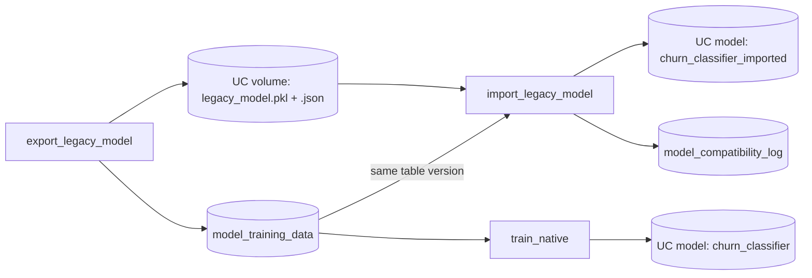

# Training and bringing existing models

## Overview

Best practice: log models with a signature, input example, and pinned requirements, validate them with `mlflow.models.predict`, prefer native flavors, ONNX, or skops over pickle, register in Unity Catalog with aliases, and use Feature Views for training-serving consistency. The guide page in the app explains the practice. This README covers the reference job.

## Reference run

One job covers both paths. It trains a scikit-learn model with MLflow and registers it in Unity Catalog. It also takes a model pickled outside MLflow, wraps it as a pyfunc, registers it, and checks that its recorded baseline metric reproduces. Both train on churn labels built from a public retail dataset. Job key: `capability_guides_model_training`.

## Data source

UCI Online Retail II: invoice lines from a UK online retailer, 2009-12-01 to 2011-12-09. License CC BY 4.0.

Chen, D. (2012). Online Retail II [Dataset]. UCI Machine Learning Repository. https://doi.org/10.24432/C5CG6D

`export_legacy_model` downloads the zip into a Unity Catalog volume, checks it against a pinned SHA-256, and builds `model_training_data`: the 2010-09-01 snapshot of 3,321 customers. `churned` means no order in the following 6 months. The job downloads nothing on a second run.

There is no published churn AUC for this dataset, so the baseline is the one the job records. The legacy pickle's holdout AUC is 0.716529, and the registered pyfunc reproduces 0.716529 (difference 0, tolerance 0.001).

## Required setup

Run these once, before the job. `<principal>` is the person or service principal behind `databricks bundle run`.

1. **Foundation bundle.** Deploy `reference/foundation` first. It creates the shared schema this guide writes to.
2. **Schema privileges.** The job creates tables, registers `churn_classifier` and `churn_classifier_imported` in Unity Catalog, and writes to the source and legacy-model volumes:
   ```sql
   GRANT USE CATALOG ON CATALOG <catalog> TO `<principal>`;
   GRANT USE SCHEMA, CREATE TABLE, CREATE MODEL, SELECT, MODIFY, READ VOLUME, WRITE VOLUME ON SCHEMA <catalog>.<schema> TO `<principal>`;
   ```
3. **Outbound internet access.** The first notebook downloads the UCI Online Retail II zip (CC BY 4.0) into the source volume, and `%pip` installs packages from PyPI. The compute needs outbound HTTPS to `archive.ics.uci.edu` and to PyPI (or an internal PyPI mirror). On serverless compute, allow both in the workspace network policy. The download runs once and later runs reuse the zip in the volume. The task stops before it changes anything if the host is unreachable. Without internet, copy the zip into the source volume yourself (the `source_volume` job parameter names it):
   ```bash
   databricks fs cp ./online+retail+ii.zip dbfs:/Volumes/<catalog>/<schema>/<source-volume>/online_retail_ii.zip
   ```

## What this shows

| Need | Artifact |
|---|---|
| Train a model | `train_native` logs params, metrics, signature, and library versions, and registers `churn_classifier` with alias `trained` |
| Bring an existing model | `export_legacy_model` pickles a pipeline to a Unity Catalog volume with plain `pickle`. `import_legacy_model` logs it as a pyfunc (Models from Code) and registers `churn_classifier_imported` with alias `imported` |
| Reproduce a baseline | The pickle's sidecar JSON records holdout AUC. The import notebook reloads the registered model, scores the same holdout, and fails if the difference exceeds 0.001 |
| Record versions | `model_compatibility_log` lists python, scikit-learn, numpy, pandas, mlflow, and scipy as recorded versus current, plus the metric. None changed in the reference run. The same values are tags on the MLflow run |

## Architecture



## Reference code

- `resources/model_training.job.yml`: three tasks and the volume parameter
- `guides/model-training-compatibility/00_start_here`: what the guide shows, the variables, links to the job
- `guides/model-training-compatibility/01_export_legacy_model`: dataset download, training table, pickle, and sidecar JSON in the `legacy_models` volume
- `guides/model-training-compatibility/02_train_native`: `mlflow.sklearn.log_model` with signature and UC registration
- `src/legacy_pyfunc.py` (`PickledModel`): pyfunc wrapper loaded from the pickle artifact
- `guides/model-training-compatibility/03_import_legacy_model`: log, register, baseline comparison, change log
- `src/ml_common.py` (`environment_versions`, `diff_environment`, `within_tolerance`)

## Demo steps

1. Run `databricks bundle run capability_guides_model_training --target dev`.
2. Open the volume `legacy_models`: the pickle and its JSON sidecar with the recorded AUC and versions.
3. Open `churn_classifier` in Catalog Explorer: version, signature, `trained` alias.
4. Open `churn_classifier_imported`: the pyfunc flavor and the pinned requirements.
5. Open the `import-legacy-pickle` run: `baseline_auc`, `reproduced_auc`, `auc_difference`, and the `env_*` and `legacy_env_*` tags.
6. Query `model_compatibility_log`: one row per library plus the metric, with a `changed` flag.
7. Edit `baseline_holdout_auc` in the sidecar JSON, rerun `03_import_legacy_model`, and watch the notebook fail on the tolerance check.

## Artifacts produced

- Models `churn_classifier` and `churn_classifier_imported` (new versions each run)
- Volume `legacy_models`, table `model_training_data`, table `model_compatibility_log`
- MLflow runs `train-native` and `import-legacy-pickle`
- A successful run of `capability-guides-model-training`

## Limitations and next steps

- The pickle is created in the same runtime that imports it, so the change log shows no package differences. Move the pickle to a runtime with different library versions to see rows flagged `changed`.
- Unpickling runs arbitrary code. Only import pickles from a source you trust.
- Matching AUC to six decimals needs the same scikit-learn version. A version change can shift it, so the tolerance is a setting in the spec.
- The baseline is a recorded number, not a published benchmark. It confirms the import reproduces the old model, not that 0.72 is a good churn score.
- Next: register a model from another framework (ONNX, PyTorch) the same way, with its own flavor or a pyfunc wrapper.
