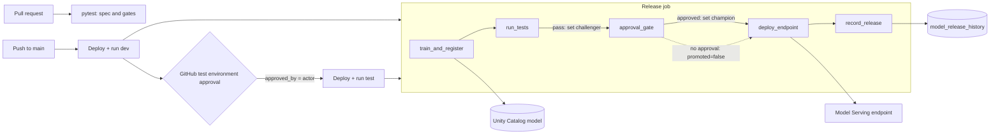

# Model release pipeline

## Overview

One serverless job takes a model from training to a live endpoint. It trains a small scikit-learn model with MLflow 3, registers it in Unity Catalog, runs automated tests, promotes it only when someone has approved it, deploys it to Model Serving, and appends a row to a release history table. A GitHub Actions workflow runs the same job in `dev` and `test`, and the GitHub `test` environment approval supplies the approver.

## What this shows

| Success criterion | Artifact |
|---|---|
| Automated tests | `run_tests` task: signature check, prediction smoke test, AUC threshold (`min_auc`), comparison against the current `@champion`. Results are tags on the model version (`test_*`, `tests_passed`). The workflow also runs `pytest` on every pull request. |
| Approval | `approval_gate` task promotes `@challenger` to `@champion` only with an approver. CI passes `approved_by=<github actor>` after the `test` environment reviewers approve. |
| Environment-specific configuration | `dev` and `test` targets in `databricks.yml`: `min_auc` 0.75 vs 0.85, `max_auc_regression` 0.02 vs 0.0, `[test]` name prefix and separate schema, separate endpoint per target, tags per target. Alias names and serving size are bundle variables. |
| Deploy an approved model version | `deploy_endpoint` task serves the `@champion` version on `capability-guides-model-<target>` (small, scale-to-zero) and waits for READY. |
| Auditable release history | `model_release_history` table, version tags (`release`, `git_sha`, `approved_by`, `job_run_id`, `training_run_url`), and the MLflow run. |

## Architecture

## Reference code

- `databricks.yml`: variables, `dev` and `test` targets, permissions
- `use_cases/general.yml`: training data columns, label, model name, features, seed
- `resources/model_release.job.yml`: the five-task serverless job. Every notebook variable is a job parameter, including `approved_by`
- `guides/model-deployment-cicd/`: one notebook per job task, in run order, plus `00_start_here` (what it shows, the variables, links to the job). Each notebook also runs on its own with Run all.
- `01_train_and_register`: generated sample data, MLflow 3 `log_model`, UC registration and version tags
- `02_run_tests` (`check_signature`) and `src/common.py` (`evaluate_gates`)
- `03_approval_gate` (`table_approver`)
- `04_deploy_endpoint` (`wait_ready`)
- `05_record_release`
- `.github/workflows/model-deployment-cicd.yml`: test on PR, deploy and run dev on main, deploy and run test after approval

## Demo steps

1. Open `use_cases/general.yml`: the data columns, label, features and seed live there.
2. Open `databricks.yml` and compare the `dev` and `test` targets (thresholds, prefix, tags).
3. Run the job with no approval: `databricks bundle run capability_guides_model_release --target dev`.
4. Show the run: tests pass, `@challenger` is set, `approval_gate` prints that it stopped, the run is green, and no endpoint was touched.
5. Run again with an approver: `databricks bundle run capability_guides_model_release --params approved_by=<name> --target dev`.
6. Open the model in Unity Catalog: version tags and the `champion` and `challenger` aliases.
7. Open the `deploy_endpoint` output: endpoint READY and the measured request latency.
8. Query the history: `SELECT * FROM <catalog>.<schema>.model_release_history ORDER BY deployed_at DESC`.
9. Open `.github/workflows/model-deployment-cicd.yml` and show where the `test` environment approval becomes `approved_by`.
10. Raise `min_auc` above the achieved AUC, redeploy, and run again: `run_tests` fails the run before any alias moves.

## Approval options

- **Job parameter (used here):** `approved_by`. Empty stops at the gate, leaves the run successful, and leaves the model unpromoted. CI sets it to the GitHub actor once the `test` environment reviewers approve.
- **Approvals table:** if `<catalog>.<schema>.model_approvals` exists and has a row with `model_name`, `model_version`, `status = 'approved'`, `approved_by` and `approved_at`, the gate accepts it. Use this when approval happens outside CI.

## Artifacts produced

- Model `<catalog>.<schema>.release_churn_classifier` with versions, `@challenger` and `@champion` aliases, and tags
- Table `churn_training_data` (seeded) and `model_release_history`
- MLflow experiment with a training run per release
- Endpoint `capability-guides-model-<target>` (small, scale-to-zero)
- A successful run of `capability-guides-model-release`

## Limitations and next steps

- Approval is a name string, not an identity check. Restrict who can trigger the job and who reviews the `test` environment.
- The endpoint is created by the job, not declared in the bundle, so the bundle does not own or destroy it. Delete it manually when done.
- The first request after scale-to-zero includes a cold start; the output records both a first and a second request.
- Training data is synthetic. A real pipeline would read a governed feature table and add fairness and drift checks to `run_tests`.
- Rollback is a re-run with the previous version's alias; there is no automatic rollback on a failed smoke test.
- Add canary traffic splitting or an AI Gateway rate limit for production use.
