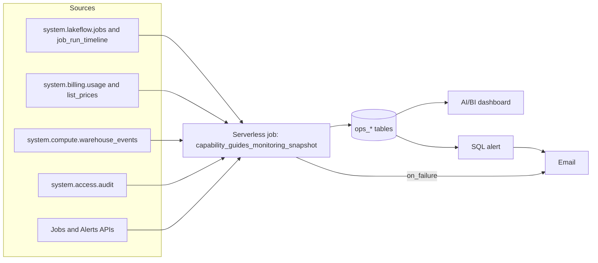

# Platform observability

## Overview

This guide gives one consolidated view of job runs, failures, usage and cost, compute and capacity, audit events, and alert routing for a workspace. A serverless job copies the data from system tables and the Jobs and Alerts APIs into seven Unity Catalog tables. An AI/BI dashboard reads those tables. A SQL alert and job failure emails show how a failure reaches a person.

Jobs tagged `capability_guide_job` are flagged, so the dashboard can show only capability guide jobs or the whole workspace. A second tag, `capability_guide_use_case`, lets you filter by use case.

## What this shows

| Success criterion | Artifact |
|---|---|
| Runs | `ops_job_runs` table, dashboard page "Runs" |
| Failures | `ops_failures` table, dashboard page "Failures" |
| Usage | `ops_usage_cost` table (DBUs and list-price cost by SKU, product and day), page "Usage and cost" |
| Compute and capacity | `ops_compute_capacity` table (serverless DBUs by workload type, SQL warehouse events), page "Compute and capacity" |
| Audit events | `ops_audit_events` table (by service, action and user), page "Audit events" |
| Alert routing | `ops_alert_routing` table (job email notifications, health rules, SQL alerts and where each sends), page "Alert routing"; the SQL alert and `on_failure` email demonstrate it end to end |

## Architecture

## Reference code

All code is in `reference/monitoring/`.

- `databricks.yml`: variables, targets and permissions.
- `use_cases/general.yml`: scoping choices (lookback days, tag keys, alert threshold and window). Override any of them with `--var`.
- `resources/job.yml`: the job (tags, `email_notifications`, health rule, job parameters) and its tasks.
- `guides/monitoring/00_start_here`: what the guide shows, the variables, and links to the job.
- `guides/monitoring/01_setup_context_and_alert_routing`: records the workspace ID and builds `ops_alert_routing` from the Jobs and Alerts APIs.
- `guides/monitoring/02_ops_job_runs` to `06_ops_audit_events`: one notebook per table, each a `CREATE OR REPLACE TABLE`. They take catalog, schema, lookback and tag keys as widgets.
- `requirements.txt`: the SDK version the setup notebook installs.
- `resources/dashboard.yml` and `src/monitoring.lvdash.json`: the dashboard.
- `resources/alert.yml`: the SQL alert.

## Demo steps

1. Deploy: `databricks bundle deploy --target dev` with `--var catalog=... --var warehouse_id=... --var app_service_principal=... --var alert_email=...`.
2. Run `databricks bundle run capability_guides_monitoring_snapshot` (or use the run button in the app). The `01_setup_context_and_alert_routing` notebook runs first, then the five table notebooks. To run by hand, open `guides/monitoring/00_start_here`, run `01`, then open any other notebook and Run all.
3. Open the job run and show the task graph and the `capability_guide_job` and `capability_guide_use_case` tags.
4. Open the dashboard. On the Runs page, use the Scope filter to switch between capability guide jobs and the whole workspace.
5. Open Failures and show termination codes and the failed run list.
6. Open Usage and cost, then Compute and capacity, to show DBUs by product and workload and warehouse start/stop events.
7. Open Audit events and show the top actions and users.
8. Open Alert routing and find the rows for this job (`on_failure` email, duration health rule) and the SQL alert.
9. Open the SQL alert. It counts guide job failures in the last 24 hours (threshold and window come from `use_cases/general.yml`) and emails `alert_email`.
10. Query a table, for example `SELECT * FROM <catalog>.<schema>.ops_failures`.

## Artifacts produced

- Tables in `<catalog>.<schema>`: `ops_context`, `ops_job_runs`, `ops_failures`, `ops_usage_cost`, `ops_compute_capacity`, `ops_audit_events`, `ops_alert_routing`.
- Dashboard: "Capability guides monitoring" (seven pages including the filters page).
- SQL alert: "capability guide job failures in the last 24h".
- Job: `capability_guides_monitoring_snapshot` and its runs.

## Reference run

The snapshot job scoped account-wide system tables to this workspace and wrote seven `ops_*` tables for a 14-day lookback (7 days for audit events). The dashboard has seven pages: runs, failures, usage and cost, compute and capacity, audit events, alert routing, and filters. One SQL alert counts guide job failures in the last 24 hours and emails the notification address. The guide's walkthrough covers the system-table map, scope, retention, and alerting patterns; the `ops_*` tables and dashboard pages are specific to this reference bundle.

## Limitations and next steps

- Data is a snapshot from the last job run. The dashboard is as fresh as the last run; add a schedule if you need it current. System tables lag by minutes to hours.
- Tables cover the current workspace only, for the lookback window (14 days of runs, usage and capacity; 7 days of audit events).
- The dashboard shows all workspace jobs by default. Use the Scope filter for the capability guide view.
- `ops_alert_routing` lists email, webhook and SQL alert destinations. `system.lakeflow.jobs` has health rules but not notification settings, so the Jobs API supplies the rest. Notification destination IDs are not resolved to names.
- Cost is list price, not negotiated price.
- The SQL alert reads `ops_failures`, so it only sees failures up to the last snapshot.
- To add another use case, deploy with a different `--var use_case=...`. The use case value is a job tag; the scoping variables in `use_cases/general.yml` are shared by all use cases. Per-use-case files would need separate targets.
