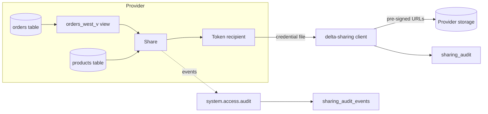

# Governed data sharing

## Overview

This guide shares a governed view and table with an outside recipient, reads them with the open-source `delta-sharing` client and nothing but the recipient credential, revokes the grant, shows the read fails, and records whether the recipient needed a copy. A serverless job runs the whole sequence and writes the result to a `sharing_audit` table and the matching Unity Catalog audit events to `sharing_audit_events`.

The code is complete, but the workspace where this guide was run (a shared metastore) does not give the job identity `CREATE SHARE` and `CREATE RECIPIENT`. The run therefore stops at the first step, records that as `BLOCKED` with the grant a metastore admin needs to run, and keeps the evidence it can produce: the governed source objects and the denied `createShare` audit event. Grant the two privileges and rerun to get the full sequence.

## What this shows

| Guide topic | Artifact |
|---|---|
| Governed share and recipient setup | `orders` table with column comments, view `orders_west_v` that keeps one region and drops `customer_email`, `products` table, share and token recipient created in `share_and_read.py` |
| Entitlement and revocation run | `GRANT SELECT ON SHARE`, a read with `delta_sharing.load_as_pandas`, `REVOKE`, a second read that must fail, recipient dropped |
| Replication requirement decision | `sharing_audit` row `replication_required` (`false`: data is shared in place) |
| Audit events | `sharing_audit_events`, from `system.access.audit` |

## Architecture

## Reference code

All code is in `reference/open-data/`.

- `use_cases/general.yml`: tables, column comments, share and recipient names, which region and columns the view keeps.
- `src/prepare_sharing_data.py`: builds the tables with dbldatagen, sets table and column comments, creates the view.
- `src/share_and_read.py`: the share lifecycle. `main` creates the share, recipient and grant, exchanges the activation link for a credential file, reads, checks that the file URLs sit under the source table's own storage path, revokes, retries the read until it fails, and drops the recipient. It reports `BLOCKED` when `CREATE SHARE` is missing.
- `src/open_data/sharing.py`: pure helpers (`credential_profile`, `served_from_source`, `strip_query`) with unit tests.
- `src/collect_share_audit.py`: polls `system.access.audit` for the share and recipient names until the closing event appears.
- `resources/data_sharing.job.yml`: the job `capability_guides_data_sharing`.

## Demo steps

1. Deploy the bundle: `databricks bundle deploy --target dev` with the variables in `databricks.yml`.
2. Run `databricks bundle run capability_guides_data_sharing`.
3. Open task `prepare_data`. The log lists the row counts and the column comments set on each table.
4. Query the view: `SELECT region, count(*) FROM <schema>.orders_west_v GROUP BY region` returns one region and no `customer_email` column.
5. Open task `share_and_read`. With the privileges in place it logs the share contents, the grant, the rows the recipient read, the storage-path check, the revoke, and the failed read.
6. Query `SELECT check, status, value, detail FROM <schema>.sharing_audit`.
7. Read the `replication_required` row. It records `false` and why.
8. Open task `collect_audit_events`, then `SELECT * FROM <schema>.sharing_audit_events ORDER BY event_time`.
9. Confirm no recipient is left: `SHOW RECIPIENTS` has no `capability_guides_partner`.

## Artifacts produced

- Tables in `<catalog>.<schema>`: `orders`, `products`, `sharing_audit`, `sharing_audit_events`.
- View: `orders_west_v`.
- Share `capability_guides_orders_share` and recipient `capability_guides_partner`, created by the job. The recipient is dropped at the end of every run, which invalidates the credential. The share stays so you can inspect its contents.
- Job: `capability_guides_data_sharing` and its runs.

## Limitations and next steps

- Creating a share needs `CREATE SHARE` and `CREATE RECIPIENT` on the metastore. In the run linked from this guide the job identity had neither, so only the `BLOCKED` path ran. The `sharing_audit_events` table shows the denied `createShare` call (status 403).
- The replication row in that run comes from how Delta Sharing works (the recipient gets pre-signed URLs to the provider's files). The storage-path check that verifies it only runs once the share exists.
- A view is shared, not a row filter: Delta Sharing does not share tables with row filters or column masks, so the view carries the restriction.
- Open sharing uses a bearer token. For recipients on Databricks, a Databricks-to-Databricks recipient avoids the token and adds recipient-side Unity Catalog governance.
- `system.access.audit` lags events by minutes. The audit task waits up to `sharing.audit_wait_seconds` in the spec.
