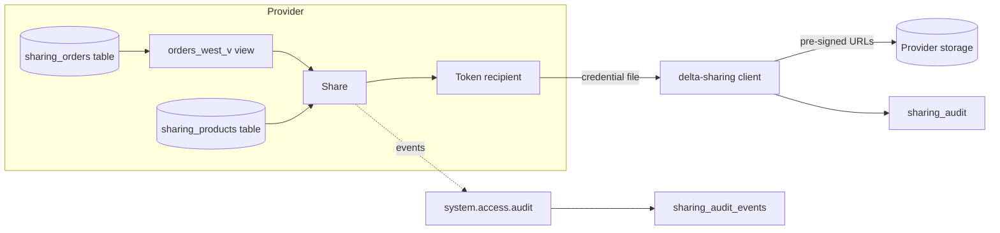

# Governed data sharing

## Overview

This guide shares a governed view and table with an outside recipient, reads them with the open-source `delta-sharing` client and nothing but the recipient credential, revokes the grant, shows the read fails, and records whether the recipient needed a copy. A serverless job runs the whole sequence and writes the result to a `sharing_audit` table and the matching Unity Catalog audit events to `sharing_audit_events`.

The code is complete, but the workspace where this guide was run (a shared metastore) does not give the job identity `CREATE SHARE` and `CREATE RECIPIENT`. The run therefore stops at the first step, records that as `BLOCKED` with the grant a metastore admin needs to run, and keeps the evidence it can produce: the governed source objects and the denied `createShare` audit event. Grant the two privileges and rerun to get the full sequence.

## Required setup

Run these once, before the job. `<principal>` is the person or service principal behind `databricks bundle run`. A metastore admin runs items 1 to 3.

1. **Share and recipient privileges.** `02_share_and_read` creates a share and a recipient. Without these grants it records `BLOCKED` and stops:
   ```sql
   GRANT CREATE SHARE, CREATE RECIPIENT ON METASTORE TO `<principal>`;
   ```
2. **Sharing outside your organization.** A token recipient is an external recipient, so the metastore must allow external Delta Sharing:
   ```bash
   databricks metastores update <metastore-id> --delta-sharing-scope INTERNAL_AND_EXTERNAL \
     --delta-sharing-recipient-token-lifetime-in-seconds <seconds> --delta-sharing-organization-name <org-name>
   ```
   The account console asks for a recipient token lifetime and an organization name when you turn this on, so the command passes both.
   Get `<metastore-id>` from `databricks metastores current`.
3. **Audit trail.** `03_collect_audit` reads `system.access.audit`. Enable the schema if it is off, then grant read access:
   ```bash
   databricks system-schemas enable <metastore-id> access
   ```
   ```sql
   GRANT USE CATALOG ON CATALOG system TO `<principal>`;
   GRANT USE SCHEMA ON SCHEMA system.access TO `<principal>`;
   GRANT SELECT ON TABLE system.access.audit TO `<principal>`;
   ```
   Without them the task stops with "system.access.audit is not readable".

## What this shows

| Guide topic | Artifact |
|---|---|
| Governed share and recipient setup | `sharing_orders` table with column comments, view `orders_west_v` that keeps one region and drops `customer_email`, `sharing_products` table, share and token recipient created in `02_share_and_read` |
| Entitlement and revocation run | `GRANT SELECT ON SHARE`, a read with `delta_sharing.load_as_pandas`, `REVOKE`, a second read that must fail, recipient dropped |
| Replication requirement decision | `sharing_audit` row `replication_required` (`false`: data is shared in place) |
| History sharing | `02_share_and_read` step 8: checks `history_data_sharing_status` on the shared table, runs `ALTER SHARE ... ADD TABLE ... WITH HISTORY` only if history is off, and records the table versions a history-enabled recipient can query in `sharing_audit` (`history_shared`, `history_versions`) |
| Audit events | `sharing_audit_events`, from `system.access.audit` |

## Architecture



## Reference code

All code is in `reference/open-data/`.

- `use_cases/general.yml`: tables, column comments, share and recipient names, which region and columns the view keeps.
- `guides/data-sharing/00_start_here`: what the guide shows, the notebooks in order, the variables, and a link to the job.
- `guides/data-sharing/01_prepare_data`: builds the tables with the sample-data generator, sets table and column comments, creates the view.
- `guides/data-sharing/02_share_and_read`: the share lifecycle. It creates the share, recipient and grant, exchanges the activation link for a credential file, reads, checks that the file URLs sit under the source table's own storage path, revokes, retries the read until it fails, and drops the recipient. Step 8 then shares the table `WITH HISTORY` (documented as the default on Databricks Runtime 16.2 and above) and records the provider-side evidence. It reports `BLOCKED` when `CREATE SHARE` is missing.
- `src/open_data/sharing.py`: pure helpers (`credential_profile`, `served_from_source`, `needs_history_readd`, `strip_query`, `audit_event_query`) with unit tests.
- `guides/data-sharing/03_collect_audit`: polls `system.access.audit` for the share and recipient names until the closing event appears.
- `resources/data_sharing.job.yml`: the job `capability_guides_data_sharing`.

## Demo steps

1. Deploy the bundle: `databricks bundle deploy --target dev` with the variables in `databricks.yml`.
2. Run `databricks bundle run capability_guides_data_sharing`.
3. Open task `prepare_data` (notebook `01_prepare_data`), or run that notebook on its own. The log lists the row counts and the column comments set on each table.
4. Query the view: `SELECT region, count(*) FROM <schema>.orders_west_v GROUP BY region` returns one region and no `customer_email` column.
5. Open task `share_and_read`. With the privileges in place it logs the share contents, the grant, the rows the recipient read, the storage-path check, the revoke, and the failed read.
6. Query `SELECT check, status, value, detail FROM <schema>.sharing_audit`.
7. Read the `replication_required` row. It records `false` and why. Read the `history_shared` and `history_versions` rows: history sharing is `ENABLED` and the table has the listed versions.
8. Open task `collect_audit_events`, then `SELECT * FROM <schema>.sharing_audit_events ORDER BY event_time`.
9. Confirm no recipient is left: `SHOW RECIPIENTS` has no `capability_guides_partner`.

## Artifacts produced

- Tables in `<catalog>.<schema>`: `sharing_orders`, `sharing_products`, `sharing_audit`, `sharing_audit_events`.
- View: `orders_west_v`.
- Share `capability_guides_orders_share` and recipient `capability_guides_partner`, created by the job. The recipient is dropped at the end of every run, which invalidates the credential. The share stays so you can inspect its contents.
- Job: `capability_guides_data_sharing` and its runs.

## Reference run

- The prepared data had `sharing_orders` with 5,000 rows, `orders_west_v` with 1,531 rows and no `customer_email`, and `sharing_products` with 3 rows.
- The job identity in the reference workspace lacked `CREATE SHARE` and `CREATE RECIPIENT` on the shared metastore. The run stopped at share creation, recorded `BLOCKED` with the grants a metastore admin needs to run, and `sharing_audit_events` shows the denied `createShare` call (status 403). With both privileges granted, the job runs the full sequence. This is a property of the reference workspace, not of OpenSharing.

## Limitations and next steps

- Creating a share needs `CREATE SHARE` and `CREATE RECIPIENT` on the metastore. In the run linked from this guide the job identity had neither, so only the `BLOCKED` path ran. The `sharing_audit_events` table shows the denied `createShare` call (status 403).
- The replication row in that run comes from how OpenSharing works (the recipient gets pre-signed URLs to the provider's files). The storage-path check that verifies it only runs once the share exists.
- The open recipient here is dropped before the history step, so the notebook shows provider-side metadata. Time travel through a shared catalog needs a Databricks-to-Databricks recipient, which this bundle does not create. History sharing is documented as Public Preview from December 2024 and enabled by default from June 2025; the cloud-token read path applies to Databricks-to-Databricks recipients.
- A view is shared, not a row filter: OpenSharing does not share tables with row filters or column masks, so the view carries the restriction.
- Open sharing uses a bearer token. For recipients on Databricks, a Databricks-to-Databricks recipient avoids the token and adds recipient-side Unity Catalog governance.
- `system.access.audit` lags events by minutes. The audit task waits up to `sharing.audit_wait_seconds` in the spec.
