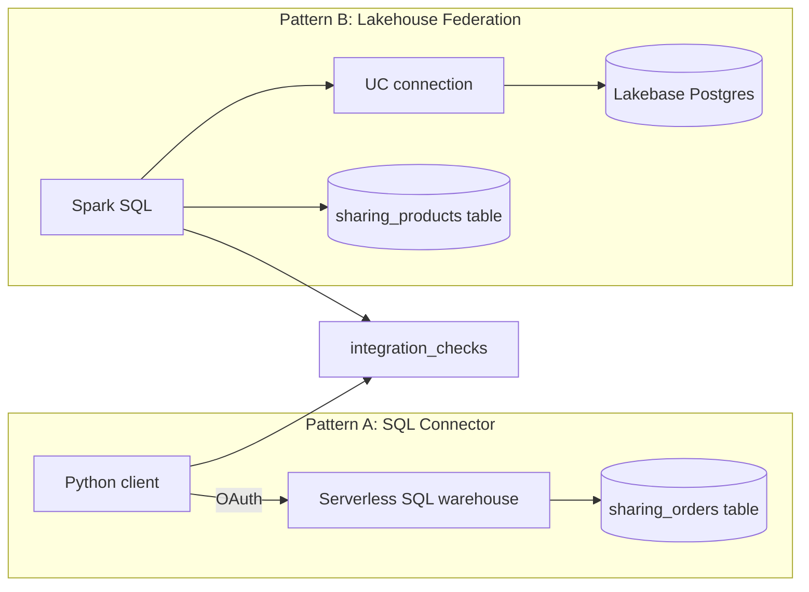

# Partner tool integrations

## Overview

This guide shows two ways tools connect to Databricks. First, a client queries a SQL warehouse through the Databricks SQL Connector for Python, which is the same HTTP path and OAuth identity that Power BI, Tableau, and custom apps use. Second, Lakehouse Federation reads an external Postgres database through a Unity Catalog connection. Because no external database is reachable from this workspace, a Lakebase Postgres project stands in as the external source. Both patterns write rows to an `integration_checks` table.

## What this shows

| Guide topic | Artifact |
|---|---|
| Two configured integrations | Task `sql_connector_client` and task `lakehouse_federation` |
| Identity and connectivity pattern | SQL Connector: `/sql/1.0/warehouses/<id>` with the job identity's OAuth token. Federation: a `POSTGRESQL` connection with a Lakebase OAuth token as password |
| End-to-end exchange | SQL Connector: 4 regions, 5,000 orders, and a named-parameter query (1,531 West orders), both matching Spark. Federation: 200 rows and the same total as Postgres, a join with a Unity Catalog table covering 200 rows, and an aggregate computed in Postgres |

## Architecture

## Reference code

All code is in `reference/open-data/`.

- `use_cases/general.yml`: the Lakebase project, branch, database, seed table, and connection names.
- `guides/external-integrations/00_start_here`: what the guide shows, the notebooks in order, and the variables.
- `guides/external-integrations/01_prepare_data`: writes the sample tables.
- `guides/external-integrations/02_sql_connector_client`: connects with `databricks.sql.connect` and a credentials provider. It uses the notebook or job identity, or an OAuth M2M service principal when the `client_id` and `client_secret` widgets are filled.
- `guides/external-integrations/03_lakehouse_federation`: seeds the Postgres table (`seed_sql` in `src/open_data/federation.py`), creates the connection, tries `CREATE FOREIGN CATALOG`, falls back to `remote_query` on the same connection, compares results with Postgres, and drops the connection.
- `resources/external_integrations.job.yml`: the job `capability_guides_external_integrations`.

## Demo steps

1. Deploy the bundle: `databricks bundle deploy --target dev`.
2. Run `databricks bundle run capability_guides_external_integrations`.
3. Open task `sql_connector_client` and read the connection settings it logs: host, `http_path`, connector version, identity.
4. Open the SQL warehouse's query history and find the two statements from the connector.
5. Open task `lakehouse_federation`. It seeds `capability_guides_external.external_orders` in the Lakebase database, creates the connection, and queries it.
6. Query `SELECT pattern, check, status, value, detail FROM <schema>.integration_checks`.
7. Confirm the connection is gone: `SHOW CONNECTIONS` has no `capability_guides_lakebase_pg`.

## Artifacts produced

- Table `<catalog>.<schema>.integration_checks`, plus `sharing_orders` and `sharing_products` as sample data.
- Table `capability_guides_external.external_orders` in the Lakebase `databricks_postgres` database.
- Job: `capability_guides_external_integrations` and its runs. The connection is created and dropped inside the run.

## Limitations and next steps

- A foreign catalog needs `CREATE CATALOG` on the metastore. The job identity did not have it, so the run recorded `foreign_catalog` as `BLOCKED` and used `remote_query` on the same connection. With the privilege, `CREATE FOREIGN CATALOG` runs and the same SQL reads `<foreign_catalog>.<schema>.<table>`.
- The connection password is a Lakebase OAuth token that expires in an hour, so the task drops the connection at the end. A long-lived connection needs a native Postgres role and password kept in a secret.
- Power BI and Tableau were not run. They use the same warehouse connection details (server hostname, HTTP path) and OAuth; the Python client demonstrates the protocol they use.
- Pass an OAuth M2M service principal (`--client-id`, `--client-secret` from a secret scope) to run the connector as an app identity instead of the job identity.
