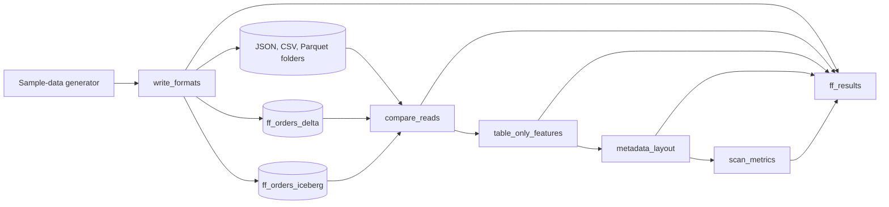

# JSON, CSV, Parquet, Delta, and Iceberg

## Overview

One generated dataset of 1,000,000 orders is written as JSON, CSV and Parquet files, a managed Delta table and a managed Iceberg table. The job measures file count and bytes, the types each reader infers, the time and scan cost of one selective query, and then tries UPDATE, DELETE, MERGE, time travel, schema changes and concurrent writes on each. A last notebook lists where Delta and Iceberg keep their metadata. Every measurement lands in `ff_results`, a run log that grows by one run each time.

It does not repeat two other guides. `file-format-ingestion` lands CSV, Excel, JSON and XML through one ingestion pipeline. `iceberg-support` covers managed Iceberg and the REST catalog read from PyIceberg. This guide compares the formats.

## Comparison matrix

Numbers are from the job run in the reference workspace: 1,000,000 rows, 8 files per format, a one-day filter reading two columns.

| | JSON | CSV | Parquet folder | Delta table | Iceberg table |
|---|---|---|---|---|---|
| Size on disk | 293.0 MB | 187.8 MB | 35.1 MB | 25.9 MB | 25.8 MB |
| Compression | none | none | snappy (Spark default on a volume) | zstd (table default) | zstd (table default) |
| Schema enforcement | none | none | none: a folder accepts any file | yes: extra column rejected | yes: extra column rejected |
| Types | inferred: int to bigint, date and timestamp to string, decimal to double (9 of 12 columns drift) | inferred: decimal to double (3 columns); nested values become text | kept in file footers (0 drift) | kept (0 drift) | kept (0 drift) |
| Nested data | yes, field order changes | no: the writer refuses structs and arrays | yes | yes | yes |
| Schema inference time | 1.9 s | 2.6 s | 0.3 s | 0 | 0 |
| Selective query, median | 0.49 s | 1.02 s | 0.54 s | 0.47 s | 0.48 s |
| Column pruning | reads 2 columns in the plan, but parses every byte | same as JSON | yes: about 2.7 MB read | yes: about 3.3 MB read | yes: about 3.4 MB read |
| Data skipping | no statistics | no statistics | files all opened (8 of 8) | 1 of 8 files read, 7 pruned | 1 of 8 files read, 7 pruned |
| Bytes read by the query | not reported by the platform | 199 MB | 2.7 MB | 3.3 MB | 3.4 MB |
| ACID | no | no | one job commits as a unit; nothing arbitrates between writers | yes | yes |
| UPDATE, DELETE, MERGE | rejected | rejected | rejected | yes | yes |
| Time travel | no | no | no | yes (`VERSION AS OF`) | yes (`VERSION AS OF`) |
| Schema evolution | none; readers merge by hand | none | `mergeSchema` on read, no guarantee | `ALTER TABLE ADD COLUMN` | `ALTER TABLE ADD COLUMN` |
| Streaming source | Auto Loader | Auto Loader | Auto Loader | Delta streaming source and change data feed | read as a batch or stream through Spark; no change data feed on managed Iceberg |
| Open engines | any | any | any | Delta readers; Iceberg readers through UniForm | any Iceberg engine through the REST catalog |

At this size the median query time is almost the same everywhere (0.47 to 0.54 s) because the data is small and the serverless cache is warm. CSV is the exception at 1.0 s. The difference shows in what the scan read: 199 MB for CSV, about 3 MB for the columnar formats, and one file instead of eight for the tables.

## What this shows

| Guide topic | Artifact |
|---|---|
| One dataset, five formats | `format_compare/json`, `csv`, `parquet` folders in a volume; tables `ff_orders_delta` and `ff_orders_iceberg`, all 1,000,000 rows |
| File count and bytes | `ff_results` rows `files` and `bytes` per format |
| Type drift | `ff_results` rows `type:<column>`, `columns_with_type_drift`, `nested:<column>` |
| Query cost | `query_seconds_median`, `plan_columns_read`, `scan_files_read`, `scan_files_pruned`, `scan_bytes_read` |
| Table-only features | `ff_results` step `features`: update, delete, merge, history, time travel, add column, failed write, concurrent writers |
| Metadata layout | `ff_results` step `metadata`: Delta log files, a commit, a checkpoint, Iceberg metadata.json, manifest list, manifests, UniForm file comparison |

## Architecture

## Reference code

All code is in `reference/open-data/`.

- `use_cases/general.yml`, section `file_formats`: the column spec for the orders.
- `guides/file-formats-delta-iceberg/00_start_here`: what the guide shows, the notebooks in order, and the variables.
- `01_write_formats`: generates the rows, writes the five formats, and records files, bytes and write time.
- `02_compare_reads`: reads each format, records inferred types, times the same query, and records the plan's columns and filters.
- `03_table_only_features`: UPDATE, DELETE and MERGE on a Parquet folder versus the two tables, history, time travel, schema evolution, schema enforcement, failed and concurrent writes. It works on `ff_work_*` copies, never on the main tables.
- `04_metadata_layout`: lists a Delta `_delta_log` and one commit and checkpoint, walks the Iceberg metadata layers through the REST catalog, and compares a UniForm table's Delta and Iceberg file lists.
- `05_scan_metrics`: waits for `system.query.history` and records files read, files pruned and bytes read.
- `src/open_data/formats.py`: pure helpers (`summarize_files`, `type_drift`, `plan_evidence`, `pair_scans`, `delta_log_summary`) with tests in `tests/test_helpers.py`.
- `resources/file_formats_compare.job.yml` and `resources/format_compare.volume.yml`: the job `capability_guides_format_compare` and the `format_compare` volume.

## Demo steps

1. Deploy the bundle: `databricks bundle deploy --target dev`.
2. Run `databricks bundle run capability_guides_format_compare`. It takes about 25 minutes, most of it waiting for the query history in the last task.
3. Query `SELECT format, metric, value FROM <schema>.ff_results WHERE step = 'write' AND metric IN ('files', 'bytes')`.
4. Compare `type:amount` and `type:order_date` across formats in the `reads` step.
5. Open `03_table_only_features` and read the UPDATE error for the Parquet folder next to the success on both tables.
6. Run `DESCRIBE HISTORY <schema>.ff_work_delta` and `SELECT * FROM <schema>.ff_work_delta VERSION AS OF 0`.
7. Open `04_metadata_layout` to see the `_delta_log` listing and the Iceberg manifest chain.
8. Each notebook also runs on its own: open it and Run all. A blank widget takes the deployed job's default.

## Artifacts produced

- Tables `ff_orders_delta`, `ff_orders_iceberg`, `ff_orders_uniform`, the working copies `ff_work_delta`, `ff_work_iceberg`, `ff_work_acid_delta`, `ff_work_acid_iceberg`, and the run log `ff_results`. The prefix `ff_` avoids the `fmt_` tables the file-ingestion guide owns.
- Volume `format_compare` with folders `json`, `csv`, `parquet`, `delta_layout` and work folders.
- Job `capability_guides_format_compare` and its runs.

Every write overwrites, so a rerun keeps the same row counts. Only `ff_results` grows.

## Findings that differ from what you might expect

- Managed Iceberg tables went generally available in Unity Catalog in 2026. They reject the DataFrame `saveAsTable` writer ("Managed Iceberg tables do not support Delta writes"); use SQL. `DESCRIBE DETAIL` works on them and reports format `iceberg`. Their data files are zstd Parquet, and the metadata sits in `_iceberg/metadata` as gzip-compressed `metadata.json`.
- UniForm is still the way to read a Delta table as Iceberg. The Iceberg metadata is generated after the Delta commit, so a client that reads right away can see the previous file list. The job retries for up to two minutes.
- Managed table storage cannot be listed from a notebook (`overlaps with managed storage`). The guide lists a Delta table at a volume path instead, and reads Iceberg metadata through PyIceberg.
- On a plain folder, UPDATE and MERGE return `UC_COMMAND_NOT_SUPPORTED`; DELETE fails with a permission-verification error.
- A single Spark job that fails halfway leaves a Parquet folder unchanged, and readers during a single overwrite saw only whole versions. The folder fails when two writers overwrite it at once: it ended with 900,000 rows from a 300,000-row and a 600,000-row write. Delta and Iceberg rejected one writer and kept the other's data.
- `system.query.history` is the source of the scan numbers. It lags by about ten minutes, redacts SQL text for job runs, and the JSON reader reports no scan metrics.

## Limitations and next steps

- Timings are from one serverless run. The query is small, so treat differences below 0.1 s as noise.
- Data skipping depends on layout: rows are range-partitioned by `order_date` so each file covers about 45 days. Unsorted data would prune far fewer files. Liquid clustering is the way to keep that layout as a table grows.
- Delta data skipping uses per-file min and max statistics; the Parquet folder gets row-group filtering only.
- Choose Delta when Databricks is the main engine and you want deletion vectors and change data feed. Choose Iceberg when other engines need a native Iceberg catalog. Use UniForm to serve both from one Delta table.
