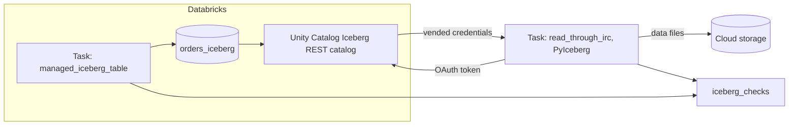

# Apache Iceberg interoperability

## Overview

This guide creates a managed Iceberg table in Unity Catalog, writes to it, adds a column, reads an earlier version with time travel, and then reads the same table from outside Spark with PyIceberg through the Unity Catalog Iceberg REST catalog. The external read authenticates with the OAuth token of the job identity and uses vended credentials, so the client never holds storage keys. Every step writes a row to an `iceberg_checks` table.

## What this shows

| Guide topic | Artifact |
|---|---|
| Read and write an Iceberg table | `orders_iceberg`, created with `USING ICEBERG` (1,000 rows), then a 500-row append |
| Schema evolution | `ALTER TABLE ... ADD COLUMN channel`, backfilled with `online` |
| Time travel | `VERSION AS OF 1` returns 1,500 rows and 7 columns, without `channel` |
| External engine query | PyIceberg reads 1,500 rows through the REST catalog and applies a `region = 'West'` filter (417 rows) |
| Catalog and external access validation | `iceberg_checks` rows `irc_configuration`, `external_schema`, `external_read`, `external_snapshots` |

## Architecture



## Reference code

All code is in `reference/open-data/`.

- `use_cases/general.yml`: source table spec, row counts, the added column, and the REST catalog path.
- `src/iceberg_table.py`: `main` creates the table, appends, adds the column, reads `VERSION AS OF`, grants `EXTERNAL USE SCHEMA` to the job identity, and records checks.
- `src/iceberg_external_read.py`: `catalog_properties` builds the PyIceberg configuration; `main` loads the table, compares row counts with Spark, and runs a filtered scan.
- `resources/iceberg.job.yml`: the job `capability_guides_iceberg` with the two tasks.

PyIceberg configuration the second task uses (the token comes from the job identity at run time):

```python
load_catalog("unity", **{
    "type": "rest",
    "uri": "https://<workspace-host>/api/2.1/unity-catalog/iceberg-rest",
    "warehouse": "<catalog>",
    "token": "<OAuth access token>",
    "header.X-Iceberg-Access-Delegation": "vended-credentials",
})
```

## Demo steps

1. Deploy the bundle: `databricks bundle deploy --target dev`.
2. Run `databricks bundle run capability_guides_iceberg`.
3. In Catalog Explorer open `orders_iceberg` and note the Iceberg provider.
4. Run `DESCRIBE HISTORY <schema>.orders_iceberg` to see CREATE TABLE AS SELECT, WRITE, ADD COLUMNS and UPDATE.
5. Run `SELECT * FROM <schema>.orders_iceberg VERSION AS OF 1` and compare the columns with the current table.
6. Open task `read_through_irc` and read the PyIceberg properties it logs (token masked).
7. Query `SELECT check, status, value, detail FROM <schema>.iceberg_checks`.
8. To use a service principal instead of the job identity, create an OAuth secret for it, grant it `EXTERNAL USE SCHEMA` and `SELECT`, and pass its access token as `token`.

## Artifacts produced

- Table `<catalog>.<schema>.orders_iceberg` (managed Iceberg) and `iceberg_checks`.
- `EXTERNAL USE SCHEMA` grant on the guide schema for the job identity.
- Job: `capability_guides_iceberg` and its runs.

## Limitations and next steps

- External access needs the metastore setting "External data access" turned on, plus `EXTERNAL USE SCHEMA` on the schema. It was on in the workspace used here.
- The job uses the OAuth token of its own identity. An external client outside Databricks would use a service principal and the OAuth machine-to-machine flow, or a personal access token, to get the same bearer token.
- Time travel in this guide uses Databricks `VERSION AS OF`. The Iceberg metadata PyIceberg sees lists 3 snapshots, not one per Databricks version, so PyIceberg snapshot time travel is a separate check to add.
- Managed Iceberg tables do not support change data feed. Use Delta with Iceberg reads enabled if you need it.
