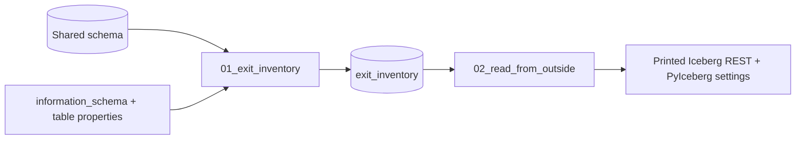

# Migrating off Databricks

## Overview

This guide builds the first artifact of an exit plan. `01_exit_inventory` lists every table and view in the shared schema from `information_schema.tables`, reads each table's properties and `DESCRIBE DETAIL`, and writes an `exit_inventory` table: format, managed or external, whether Iceberg clients can read it, the Delta features that outside readers must support, location, size, and a portability verdict (runs as is, needs changes, or rebuild). `02_read_from_outside` prints the Iceberg REST endpoint and the PyIceberg configuration an outside engine uses. It never connects to an outside system.

## Required setup

Only a real outside read needs this. The notebooks run without it.

1. **External data access on the metastore.** A metastore admin turns it on:
   ```bash
   databricks metastores update <metastore-id> --external-access-enabled
   ```
2. **EXTERNAL USE SCHEMA** on the schema for the principal the outside engine uses:
   ```sql
   GRANT EXTERNAL USE SCHEMA ON SCHEMA <catalog>.<schema> TO `<principal>`;
   ```

## Architecture



## Reference code

All code is in `reference/open-data/`.

- `guides/migrate-off-databricks/00_start_here`: what the guide does and the variables.
- `guides/migrate-off-databricks/01_exit_inventory`: reads the metadata and writes `exit_inventory`.
- `guides/migrate-off-databricks/02_read_from_outside`: reports the metastore setting and prints the outside-engine configuration.
- `src/open_data/exit_inventory.py`: pure helpers that detect reader-side features, Iceberg readability, and the verdict.
- `resources/migrate_off_databricks.job.yml`: the job `capability_guides_migrate_off_databricks` with two tasks.

## Demo steps

1. Deploy the bundle: `databricks bundle deploy --target dev`.
2. Run `databricks bundle run capability_guides_migrate_off_databricks`.
3. Query `SELECT verdict, count(*) FROM <schema>.exit_inventory GROUP BY verdict`.
4. Filter on `reader_features IS NOT NULL` to see tables whose features outside readers must support.
5. Open task `read_from_outside` and read the printed PyIceberg configuration.

## Artifacts produced

- Table `<catalog>.<schema>.exit_inventory`.
- Job: `capability_guides_migrate_off_databricks` and its runs.

## Limitations and next steps

- The inventory covers one schema. Loop over `information_schema.schemata` for the whole catalog.
- Size comes from `DESCRIBE DETAIL`, so it is empty for managed Iceberg tables, views, and tables the account cannot read.
- The feature list follows the Databricks feature compatibility page: features marked reader and writer (column mapping, deletion vectors, type widening, VARIANT, TIMESTAMP_NTZ, liquid clustering, catalog commits) plus v2 checkpoints from the Delta protocol spec. Writer-only features such as row tracking are not flagged. Check the target engine's release notes for support.
- Egress and storage cost are not in the table. Multiply `size_bytes` by your cloud's egress rate.
