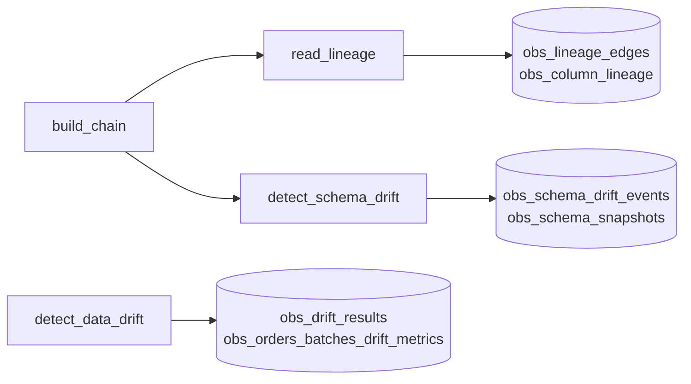

# Lineage and drift detection

## Overview

The `capability-guides-observability` job builds a three-table chain (`obs_source_orders` to `obs_silver_orders` to `obs_gold_daily_revenue`) with SQL, then reads that chain back from `system.access.table_lineage` and `system.access.column_lineage`. It changes the silver table's schema and detects the change from `information_schema` snapshots and `DESCRIBE HISTORY`. It loads a later batch with a shifted distribution and flags it with a Unity Catalog data profiling monitor plus PSI and mean-shift checks computed in the job. Every result lands in a table.

## What this shows

| Capability | Artifact |
|---|---|
| Lineage from system tables | `obs_lineage_edges`: silver to gold (1 hop upstream) and source to silver (2 hops), both written by a job |
| Column lineage | `obs_column_lineage`: 10 column edges, such as `amount` to `revenue` |
| Schema drift from Delta history | `obs_schema_drift_events`: `loyalty_tier` added (history version 1), `quantity` changed from int to long (version 3) |
| Snapshots behind the diff | `obs_schema_snapshots` (before and after) and `obs_schema_history` |
| Data drift from a monitor | `obs_orders_batches_drift_metrics`, written by the monitor on `obs_orders_batches` |
| Data drift checks in the job | `obs_drift_results`: PSI on `amount` 4.94 and on `region` 1.89 (limit 0.2); `amount` mean 105.6 to 250.9 (+137.5%, limit 15%) |

## Architecture



## Reference code

- `resources/observability.job.yml`: four tasks; `detect_data_drift` has no upstream task
- `guides/data-observability/00_start_here`: what the guide shows, the variables, links to the job
- `guides/data-observability/01_build_chain`: the chain, built with `CREATE OR REPLACE TABLE ... AS SELECT`
- `guides/data-observability/02_read_lineage`: polls `system.access.table_lineage`, walks upstream from gold, then reads `column_lineage`
- `guides/data-observability/03_detect_schema_drift`: `snapshot`, the `ALTER TABLE` changes, and the diff
- `guides/data-observability/04_detect_data_drift`: monitor create and refresh, PSI, and mean shift
- `src/guide_lib.py`: `psi`, `quantile_edges`, `diff_schemas`, `schema_changing_history`, covered by `tests/test_guide_lib.py`

## Demo steps

1. Run `capability-guides-observability`. The lineage task polls until the system table shows the chain, about 13 minutes after the writes in the reference run.
2. Query the chain:
   ```sql
   SELECT hops_upstream_of_gold, source_table, target_table FROM <catalog>.<schema>.obs_lineage_edges;
   ```
3. Open `obs_silver_orders` in Catalog Explorer and show the Lineage tab for the same chain.
4. Query the schema drift events and the Delta history rows they match:
   ```sql
   SELECT change_type, column_name, old_type, new_type, history_version, history_operation
   FROM <catalog>.<schema>.obs_schema_drift_events;
   ```
5. Query the in-job drift checks:
   ```sql
   SELECT method, column_name, metric, metric_value, threshold, flagged FROM <catalog>.<schema>.obs_drift_results;
   ```
6. Open the monitor on `obs_orders_batches` (table, Quality tab) and its drift metrics table. The first window shows distance 0 for `amount`; the window after the shifted batch shows a Wasserstein distance of 72.56.

## Artifacts produced

- Tables: `obs_source_orders`, `obs_silver_orders`, `obs_gold_daily_revenue`, `obs_lineage_edges`, `obs_column_lineage`, `obs_schema_snapshots`, `obs_schema_history`, `obs_schema_drift_events`, `obs_orders_batches`, `obs_drift_results`, `obs_monitor_status`
- Monitor outputs: `obs_orders_batches_profile_metrics`, `obs_orders_batches_drift_metrics`
- A data profiling monitor on `obs_orders_batches`, created by the job (not declared in the bundle); its assets folder is `monitor_assets` under the bundle's files path

## Limitations and next steps

- Lineage appears in system tables with a delay. The job waits up to 25 minutes.
- Information schema and `DESCRIBE HISTORY` both report the widened type as `long`, not `bigint`.
- Creating the monitor starts a refresh and the job requests another, so the first two monitor windows both see the baseline. Drift appears in the third window.
- The monitor outlives the job. The job deletes and recreates it on the next run. To remove it, call `delete_monitor` or run `DROP QUALITY MONITOR` on `obs_orders_batches`.
- A real pipeline would run the monitor on a schedule and alert on its metrics table.
