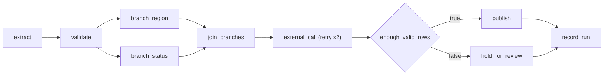

# Orchestration patterns

## Overview

One Lakeflow Job, `capability-guides-orchestration`, shows the patterns an orchestration tool needs: tasks that pass values, two parallel branches that join, a schedule, a retry policy, email alerts with a duration health rule, a call to an external process, and a branch on a condition. A second job, `capability-guides-bulk-pause`, pauses every scheduled job tagged `capability_guide_job` in one operation, records the before and after states, and restores the jobs it paused.

## What this shows

| Pattern | Where it lives |
|---|---|
| Sequential tasks that pass values | `extract` sets `row_count`; `validate` reads it with `dbutils.jobs.taskValues` and sets `valid_rows` |
| Two parallel branches that join | `branch_region` and `branch_status` both depend only on `validate`; `join_branches` waits for both |
| Schedule, paused in dev | `schedule` with cron `0 0 6 * * ?` and `pause_status: PAUSED` |
| Task retry policy | `external_call`: `max_retries: 2`, 10 s interval. Attempt 0 fails on purpose; attempt 1 succeeds |
| Alerts | `email_notifications` on success, failure, and duration warning, plus a `RUN_DURATION_SECONDS` health rule |
| External process | `external_call` runs `python3 --version` with `subprocess` and sends an HTTP GET to a public endpoint |
| Condition branch | `enough_valid_rows` compares the `valid_rows` task value with the `min_valid_rows` job parameter; `publish` runs on true, `hold_for_review` on false |
| Bulk pause and resume | `capability-guides-bulk-pause` and the `bulk_pause_log` table |

## Architecture



## Reference code

- `resources/orchestration_patterns.job.yml`: the whole task graph, schedule, retry, notifications, health rule, condition
- `guides/orchestration-patterns/00_start_here`: what the guide shows, the variables, links to both jobs
- `guides/orchestration-patterns/02_validate`: reads one task value, sets two more
- `guides/orchestration-patterns/05_external_call`: shell command, HTTP request, and the fail-once marker that makes the retry visible
- `guides/orchestration-patterns/08_bulk_pause_prepare` to `11_bulk_pause_cleanup_probe`: the four bulk pause phases, one notebook each
- `src/bulk_pause.py` and `resources/bulk_pause.job.yml`: `tagged_scheduled_jobs`, `set_status`, and the job wiring
- `src/guide_lib.py`: `plan_pause_change` and `count_states`, covered by `tests/test_guide_lib.py`

## Demo steps

1. Open `capability-guides-orchestration` and show the graph: a chain, a fan-out to two branches, and a join.
2. Open the latest run. `external_call` shows two attempts: attempt 0 failed with the simulated transient error, attempt 1 succeeded.
3. Open `validate` and `join_branches` output to show values arriving from upstream tasks.
4. Open `enough_valid_rows`: the condition evaluated 2341 > 2000, so `publish` ran and `hold_for_review` shows as excluded.
5. Open the job settings: the paused schedule, the three email notifications, and the duration health rule.
6. Query what the job recorded:
   ```sql
   SELECT task_key, result_state, attempt_number, duration_s FROM <catalog>.<schema>.orch_task_log ORDER BY started_at;
   SELECT kind, target, result FROM <catalog>.<schema>.orch_external_calls;
   ```
7. Run `capability-guides-bulk-pause` and query the states it recorded:
   ```sql
   SELECT phase, job_name, schedule_status FROM <catalog>.<schema>.bulk_pause_log ORDER BY recorded_at;
   ```

## Artifacts produced

- Tables: `orch_orders_raw`, `orch_orders_valid`, `orch_summary_by_region`, `orch_summary_by_status`, `orch_run_summary`, `orch_external_calls`, `orch_attempt_marker`, `orch_branch_outcomes`, `orch_published_summary`, `orch_task_log`, `bulk_pause_log`
- Orchestration run: 2400 rows extracted, 2341 valid, 4 regions and 3 statuses summarized, `external_call` succeeded on its second attempt, `publish` ran
- Bulk pause run: 2 tagged scheduled jobs found; the 1 unpaused job (a probe job the run creates) was paused, then restored to unpaused; the job that was already paused stayed paused

## Limitations and next steps

- The bulk pause job creates a short-lived probe job with an unpaused yearly schedule, because dev mode keeps every bundle schedule paused. It deletes the probe at the end.
- Resume restores only the jobs that this run paused. Run it as one job so the log row that links the two steps exists.
- The HTTP target is a public endpoint named in the use-case spec. If your network blocks it, change `orchestration.http_probe_url`.
- Notifications go to email. Webhook destinations use the same `webhook_notifications` block.

## Reference run

Numbers from the recorded run of the bundle job.

- The job has eleven tasks. `record_run` writes one row per task to `orch_task_log`.
- Results: `extract` (2,400 rows) 47 s, `validate` (2,341 valid) 24 s, `branch_region` (4 groups) 26 s, `branch_status` (3 groups) 27 s, `publish` 28 s, all at attempt 0. `external_call` failed at attempt 0 after 22 s and succeeded at attempt 1 after 59 s. The condition was true, so `hold_for_review` was excluded.
- `external_call` fails on purpose at attempt 0 (a marker row makes it happen once per run), runs `python3 --version` through `subprocess`, and makes an HTTP GET that returned 200 in 117 ms.
- Settings: schedule `0 0 6 * * ?` in UTC with `pause_status: PAUSED`; `external_call` retries up to 2 times, 10 s apart, including on timeout; a health rule on `RUN_DURATION_SECONDS` greater than 900; email on success, failure, and duration warning.
- Bulk pause: the job found 2 tagged scheduled jobs. A probe job went from UNPAUSED to PAUSED and back, and the orchestration job stayed PAUSED throughout. Dev mode keeps bundle schedules paused, so the probe gives the pause something to change.
