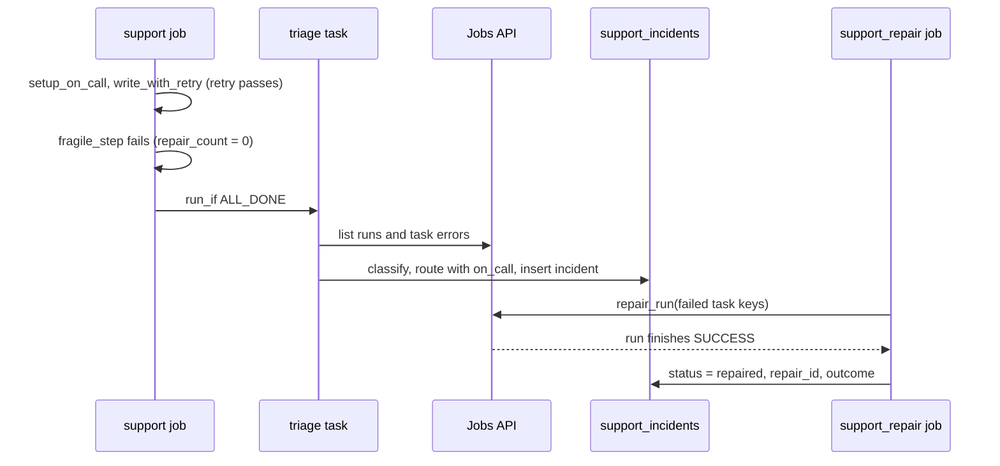

# Support and recovery

## Overview

The `capability-guides-operational-support` job fails one task on purpose, then triages every failed capability guide run, classifies each error, and routes it to an owner from an `on_call` table. A second job, `capability-guides-support-repair`, repairs the failed run through the Jobs API repair endpoint and records the outcome. Everything lands in `support_incidents`.

## What this shows

| Success criterion | Artifact |
|---|---|
| Triage an incident | `triage` finds failed tasks of jobs tagged `capability_guide_job` through the Jobs API, cross-checks `system.lakeflow.job_run_timeline`, and classifies each error with the spec's patterns |
| Restart or recover | `fragile_step` fails while `{{job.repair_count}}` is 0. `05_repair_failed_run` calls `repair_run` for the failed task keys, waits, and sets the incident to `repaired` |
| Resiliency approach | `write_with_retry` (retries, timeout, keyed MERGE) and the settings table below |
| Escalation path and ownership | `on_call` maps job tags to owner and escalation contacts. Triage picks the row for each failed job and writes the route into `support_incidents` |

## Architecture

## Reference code

- `resources/operational_support.job.yml`: four tasks. `triage` uses `run_if: ALL_DONE`; `write_with_retry` sets `max_retries`, `timeout_seconds`, and `retry_on_timeout`.
- `guides/operational-support/`: `00_start_here` plus `01_setup_on_call`, `02_write_with_retry` (dbldatagen work items, MERGE), `03_fragile_step`, `04_triage` and `05_repair_failed_run`. Each notebook also runs on its own with Run all.
- `src/support_lib.py`: `classify`, `match_on_call`, `route_for`, `latest_attempts` (a task that passed on retry is not an incident), `pick_repair_target`
- `05_repair_failed_run`: finds the newest unrepaired failed run, calls `repair_run`, updates the incident
- `use_cases/general.yml`: the `support` section holds error classes, severities, and the `on_call` rows

## Demo steps

1. Show `on_call` in the spec: a row per job tag, a use-case row, and a `*` fallback.
2. Run `databricks bundle run capability_guides_operational_support --target dev`. It ends as succeeded with one failed task.
3. Open the run. `write_with_retry` shows two attempts (fail, pass). `fragile_step` shows one failed attempt.
4. Query the incident: `SELECT run_id, task_key, error_class, severity, route, status FROM <catalog>.<schema>.support_incidents ORDER BY detected_at DESC;` The `fragile_step` row is class `transient`, severity `low`, route `notify platform-support@example.com; escalate to platform-lead@example.com after 30 min`.
5. Find a `permission` row from another guide job. Its route pages the owner and the escalation contact.
6. Run `databricks bundle run capability_guides_support_repair --target dev`.
7. Open the original run again. It shows a repair entry and finishes as SUCCESS. The incident now has `status = repaired`, a `repair_id`, and an outcome.

## Resiliency approach

| Setting | Use it when |
|---|---|
| `max_retries` with `min_retry_interval_millis` | The failure is transient, such as an upstream outage. The reference task retries twice at 10 seconds. |
| `timeout_seconds` | A task can hang. Pair it with `retry_on_timeout` only if a second attempt is safe. |
| Keyed `MERGE` or `INSERT ... WHERE NOT EXISTS` | Always, for writes inside a retried or repaired task. `write_with_retry` leaves 25 rows however often it runs. |
| `run_if: ALL_DONE` | A task such as triage or cleanup must run even when upstream tasks fail. |
| Repair run | A task failed for a reason you have since fixed. Repair reruns only failed tasks and keeps successful results. |
| `max_concurrent_runs: 1` | Two runs writing the same table would conflict. |

## Artifacts produced

- Tables: `on_call` (5 rows), `support_incidents`, `support_work_items` (25 rows)
- Jobs: `capability_guides_operational_support` and `capability_guides_support_repair`
- Reference runs: support run 787779100759308 ended as succeeded with one failed task. Repair run 473831755972947 repaired it as repair 305177685386087, and the original run finished as SUCCESS.

## Limitations and next steps

- Triage records incidents with `status = open` and does not close them. Only the repair job sets `repaired`; a run fixed by hand stays open.
- Contacts in `on_call` are placeholders on the reserved `example.com` domain. The job records the route but sends nothing. Wire `route` to a notification destination or pager to deliver it.
- `fragile_step` fails because `{{job.repair_count}}` is 0. It models a transient dependency, not a real one.
- System tables lag job runs, so the cross-check can trail the Jobs API. Incidents come from the API first; a system-table row is added only for runs the API pass did not return.
- Triage covers the lookback window set in the spec (168 hours). Failures older than that need a wider window.
