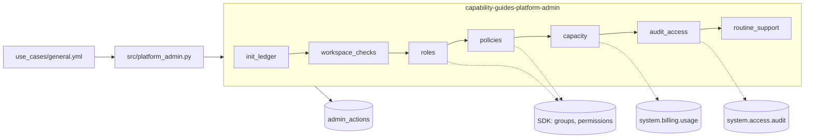

# Workspace and account administration

## Overview

One job, `capability-guides-platform-admin`, scripts routine administrator tasks with the Databricks SDK and system tables. Each task is idempotent and writes its findings to an `admin_actions` table. The job changes only objects whose names start with `capability-guides-`, and it deletes nothing.

## What this shows

| Success criterion | Artifact |
|---|---|
| Set up workspaces | `workspace_checks` records caller identity, workspace ID, metastore, and five workspace settings (token policy, IP access lists, and others) |
| Set up roles | `roles` finds or creates the workspace group `capability-guides-analysts`, then tries to grant it schema access |
| Apply policies | `policies` tries a serverless budget policy, then applies the cluster policy `capability-guides-policy` and edits it only if its definition drifts |
| Manage capacity | `capacity` flags warehouses with auto-stop off or above 60 minutes and sums serverless DBUs from `system.billing.usage` |
| Read audit logs | `audit_access` groups the last 7 days of `system.access.audit` by service and action |
| Handle routine support | `routine_support` lists failed job runs from the last 24 hours and workspace tokens that expire within 30 days |

## Architecture

## Reference code

- `resources/platform_admin.job.yml`: seven sequential serverless tasks, one parameterised script
- `src/platform_admin.py`: one function per task. `roles` finds a group before creating it. `policies` finds a policy by name before creating it.
- `src/admin_lib.py`: `ledger_merge_sql` (keyed MERGE so a retried task never duplicates rows), `is_owned_name` (prefix guard), `evaluate_warehouse`, `tokens_expiring`
- `use_cases/general.yml`: the `admin` section holds the group, privileges, policy definition, settings keys, and lookback windows
- `tests/test_helpers.py`: unit tests for the pure helpers

## Demo steps

1. Open `use_cases/general.yml` and show the `admin` section: every name and threshold lives there.
2. Run `databricks bundle run capability_guides_platform_admin --target dev`.
3. Open the run and read the `roles` task output. The group row says `created` on the first run and `unchanged` afterwards.
4. Read the `grant_schema_access` row. It says `not_allowed` because a workspace-local group is not a Unity Catalog principal. The next row sets `CAN_USE` on the cluster policy instead.
5. Query the ledger: `SELECT category, action, target, status, detail FROM <catalog>.<schema>.admin_actions WHERE run_id = '<run id>' AND status <> 'ok';`
6. Read the `capacity` rows: one warehouse (Small, auto-stop 10 minutes) and the top serverless SKUs by DBUs.
7. Run the job again. The group and the cluster policy show `unchanged`, and no new objects appear.

## Artifacts produced

- Table: `admin_actions` (111 rows across 3 runs in the reference workspace; 53 rows per run)
- Objects: workspace group `capability-guides-analysts`, cluster policy `capability-guides-policy`
- Reference run: job `capability_guides_platform_admin`, run 306932051442801. Task results: 8 workspace rows ok, 12 capacity rows ok, 16 audit rows ok, 9 failed-run rows flagged, 1 budget policy `not_allowed`, 1 schema grant `not_allowed`.

## Limitations and next steps

- Unity Catalog grants need an account-level group. The job creates a workspace-local group, so the schema grant is refused and recorded. Create the group at the account level (SCIM or Terraform) to complete it.
- The budget-policies API returned Not Found at the workspace level in the reference workspace. Budget policies are managed from the account console or account API.
- Token listing returned 0 tokens, so the expiry check had nothing to flag. It needs admin rights to see other users' tokens.
- The job runs as the deploying user, who is a workspace admin. Run it as a service principal in a real deployment and grant that principal read access to the system tables.
- The ledger records what the job saw. It does not alert; add a SQL alert on `status = 'flagged'` if you need one.
