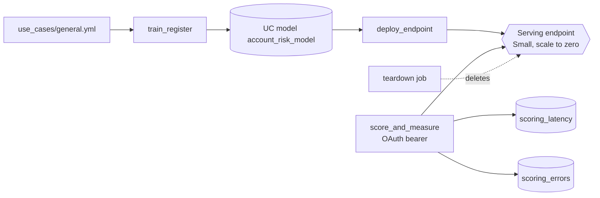

# Online model scoring

## Overview

One job trains a small model, registers it in Unity Catalog, deploys it to a Model Serving endpoint, and scores it over HTTPS with an OAuth token from the Databricks SDK. It times every request and records how the endpoint answers bad requests. A second job deletes the endpoint, so nothing keeps running after the demo.

## What this shows

| Question | Artifact |
|---|---|
| Is the request secured? | `score_endpoint.py` sends `WorkspaceClient().config.authenticate()` as the bearer header. No PAT or secret appears in the code. |
| How fast is it? | `scoring_latency`: one row per request, with `phase` = `first_request`, `warm` (50 sequential), or `concurrent` (20 requests, 5 workers). |
| What happens on bad input? | `scoring_errors`: one row per failure scenario with the HTTP status, the error message, and whether the status matched what the guide expects. |
| How does it scale? | The endpoint is `Small` with scale-to-zero on. See "Scaling approach" below. |
| Is anything left running? | `capability_guides_realtime_scoring_teardown` deletes the endpoint and confirms it is no longer listed. |

Reference run (job `capability_guides_realtime_scoring`, run 1082287396068690):

| Phase | Requests | p50 | p95 | Max |
|---|---|---|---|---|
| first request | 1 | 120.7 ms | n/a | 120.7 ms |
| warm, sequential | 50 | 43.6 ms | 99.7 ms | 117.5 ms |
| concurrent (5 workers) | 20 | 40.6 ms | 74.6 ms | 83.7 ms |

The first request in that run was not a cold start. The job updated an endpoint that was already serving, so the first request found a running replica. A cold start only happens when a request reaches an endpoint that has scaled to zero after sitting idle; rerun `score_and_measure` after the idle period and the `first_request` row will show it.

| Failure scenario | Status | Result |
|---|---|---|
| Body is not valid JSON | 400 | Rejected, error recorded |
| Valid JSON, unknown top-level key | 400 | Rejected, error recorded |
| Required feature omitted | 400 | Rejected: "Model is missing inputs" |
| Optional feature omitted | 200 | Scored; the model fills the training median |

## Architecture



## Reference code

- `use_cases/general.yml`: features, label, endpoint size, request counts
- `src/train_register.py`: `main` (dbldatagen data, scikit-learn pipeline, UC registration, `champion` alias)
- `src/deploy_endpoint.py`: `main` (create or update, route optimization if requested, readiness polling)
- `src/score_endpoint.py`: `main` and `auth_headers` (OAuth, timing, failure scenarios, table writes)
- `src/scoring_helpers.py`: `percentile`, `summarize`, `error_cases`
- `resources/realtime_scoring.job.yml` and `resources/realtime_scoring_teardown.job.yml`

## Demo steps

1. Deploy the bundle and run `capability_guides_realtime_scoring`. The `deploy_endpoint` task takes several minutes while the endpoint provisions.
2. Open the endpoint in the Serving page. It shows `Small` and scale-to-zero on.
3. Read the `score_and_measure` output: the `SUMMARY` line has first-request, warm, and concurrent figures.
4. Query latency:
   ```sql
   SELECT phase, count(*) AS requests,
          round(percentile(latency_ms, 0.5), 1) AS p50_ms,
          round(percentile(latency_ms, 0.95), 1) AS p95_ms
   FROM <catalog>.<schema>.scoring_latency
   GROUP BY phase;
   ```
5. Query failures: `SELECT scenario, status_code, handled, outcome, error_message FROM <catalog>.<schema>.scoring_errors;`
6. Run `capability_guides_realtime_scoring_teardown` and check that the endpoint is gone from the Serving page.

## Scaling approach

- **Scale-to-zero.** The endpoint releases its compute after idle time, so an idle endpoint costs nothing. The next request waits for a replica to start, which is the cold start. Use it for demos, dev, and low-traffic models. Turn it off for endpoints with a latency target, because it removes the cold start.
- **Concurrency.** Capacity is provisioned concurrency: the number of requests the served entity handles at once. `workload_size` (`Small`, `Medium`, `Large`) sets the range, and the endpoint scales within it as load changes. Requests above capacity queue, so queue depth and p95 latency are the signals to raise the size. The concurrent phase sends 20 requests through 5 workers to exercise this.
- **Route optimization.** A faster path that skips parts of the standard request route. It requires a JWT OAuth token scoped to the endpoint, obtained by exchanging a user or service principal token at `/oidc/v1/token`. `score_endpoint.py` implements that exchange. The serverless job token in the reference run is not a JWT, so the run keeps `route_optimized: false`. Flip it in the spec when the scoring identity can mint a JWT.
- **Provisioned throughput.** A separate endpoint type for foundation models (LLMs) that reserves token throughput. It does not apply to this scikit-learn model; it is the option when the served model is an LLM and the workload needs guaranteed tokens per second.

## Artifacts produced

- Unity Catalog model `account_risk_model` (alias `champion`) and table `scoring_training_data`
- Tables `scoring_latency` (71 rows) and `scoring_errors` (4 rows) for the reference run
- Serving endpoint `capability-guides-realtime-scoring`, deleted by the teardown job

## Limitations and next steps

- Latency is measured from a serverless job in the same region. A client elsewhere adds network time.
- The reference run does not capture a real cold start; see the note above.
- The endpoint name is fixed per workspace, so two bundle deployments in one workspace share it. Set the `endpoint_name` job parameter to separate them.
- Next: turn on route optimization with a JWT-capable identity, add AI Gateway rate limits and inference tables, and compare `Small` against `Medium` under the same load.
