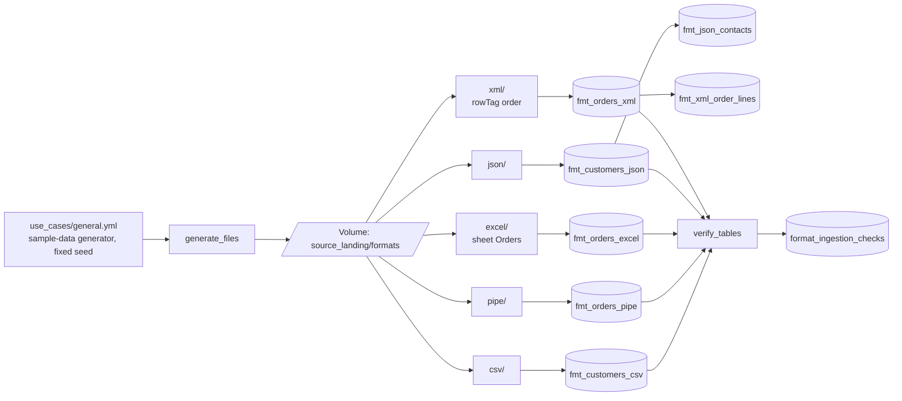

# File format ingestion

## Overview

Land each file format with Auto Loader or read_files and the options it needs, find new files with file events, handle schema drift with hints, an evolution mode, and rescued data, load volatile JSON as Variant, and parse documents with ai_parse_document. Verify counts, types, and rescued rows after each load. This reference ingests five formats with one pipeline.

## What this shows

| Format | Table | Rows | What the check confirms |
|---|---|---|---|
| CSV with header | `fmt_customers_csv` | 200 | `credit_limit` is `decimal(12,2)`, `created_date` is `date`, no rescued rows |
| Pipe-delimited | `fmt_orders_pipe` | 1,000 | 301 notes contain a pipe inside quotes and stay in one column; the amount sum matches the source |
| Excel, sheet `Orders` | `fmt_orders_excel` | 1,000 | only the `Orders` sheet is read; the `README` and `Products` sheets add no columns |
| Nested JSON | `fmt_customers_json`, `fmt_json_contacts` | 200 documents, 267 contacts | `address` is a struct, `contacts` is an array that explodes to 267 rows, the optional `loyalty` struct is present on 40 documents |
| XML | `fmt_orders_xml`, `fmt_xml_order_lines` | 100 orders, 250 lines | the repeating `<line>` node explodes to 250 rows, the optional `<coupon>` node is present on 25 orders and NULL on 75 |

The checks are rows in `format_ingestion_checks`. The `verify_tables` task fails the job if any check fails.

## Architecture



## Reference code

- `file-format-ingestion/01_generate_files` and `src/source_ingestion/file_writers.py`: build each file shape from plain rows. Volumes do not support random-access writes, which zip-based `.xlsx` needs, so the notebook writes locally and copies to the volume.
- `file-format-ingestion/pipeline/*.sql`: one dataset per file. Options per format: `delimiter` and `quote`, `dataAddress`, `multiLine`, `rowTag`, and `schemaHints`.
- `file-format-ingestion/02_run_pipeline` and `03_verify_tables`: run or inspect the pipeline, then run the checks.
- `resources/file_formats.job.yml` and `resources/file_formats.pipeline.yml`.
- `tests/test_helpers.py`: quoting, workbook sheets, XML and JSON counts.

## Demo steps

1. Open the latest run of `capability-guides-file-formats`. The `generate_files` output prints the row counts and how many notes contain a pipe.
2. Open the pipeline update from `ingest_formats` and show the graph: five Auto Loader streaming tables and two materialized views.
3. Show quoting at work:
   ```sql
   SELECT order_id, notes FROM <catalog>.<schema>.fmt_orders_pipe WHERE notes LIKE '%|%' LIMIT 5;
   ```
4. Show the single sheet:
   ```sql
   SELECT * FROM read_files('/Volumes/<catalog>/<schema>/source_landing/formats/excel/',
     format => 'excel', operation => 'listSheets', schemaEvolutionMode => 'none');
   DESCRIBE TABLE <catalog>.<schema>.fmt_orders_excel;
   ```
5. Show nested types and the optional node:
   ```sql
   DESCRIBE TABLE <catalog>.<schema>.fmt_customers_json;
   SELECT count(*) AS orders, count(coupon) AS with_coupon FROM <catalog>.<schema>.fmt_orders_xml;
   ```
6. Read the checks:
   ```sql
   SELECT table_name, check_name, expected, actual, passed FROM <catalog>.<schema>.format_ingestion_checks
   ORDER BY checked_at DESC, table_name;
   ```

## Reference run

One job generates five sample files from the use-case spec, ingests them with one Lakeflow Declarative Pipeline, and checks each table against the spec. The formats are a CSV file, a pipe-delimited file with quoted embedded delimiters, a multi-sheet Excel workbook of which one named sheet is read, nested JSON, and XML with repeating and optional nodes. Auto Loader (`read_files`) ingests all five.

Artifacts:

- Job `capability-guides-file-formats` (tag `capability_guide_job: capability_guides_file_formats`) and pipeline `capability-guides-file-formats`
- Seven pipeline tables above plus `format_ingestion_checks`
- Sample files in the `source_landing` volume under `formats/`

## Limitations and next steps

- The job regenerates the files on every run and the pipeline runs a full refresh, so counts are the same each run. For files that arrive over time, remove `full_refresh` and Auto Loader ingests only new files.
- Excel `dataAddress` accepts a sheet name (`Orders`) or a range with a colon (`Orders!A1:G1001`). A single cell such as `Orders!A1` fails. Excel in Auto Loader needs `schemaEvolutionMode => 'none'`.
- XML attributes arrive with an underscore prefix (`_id`, `_sku`). Rename them in the first downstream view.
- The checks cover shape and counts. Add business rules (expectations) once the formats land.
