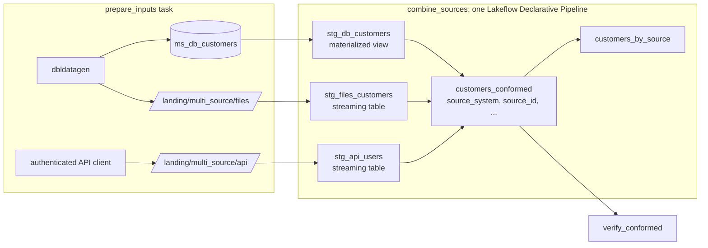

# Multi-source pipeline

## Overview

One Lakeflow Declarative Pipeline reads three sources in three shapes: a database extract (a Delta table), landed CSV files, and API pages landed as JSON lines. Each source maps its own column names into one shape and tags every row with a `source_system` value. The result is one conformed `customers_conformed` table with 260 rows: 120 from the database, 80 from files, and 60 from the API.

## What this shows

| Capability | Artifact |
|---|---|
| Single pipeline graph with three sources | `stg_db_customers`, `stg_files_customers`, `stg_api_users` feed `customers_conformed` in one pipeline |
| Different source shapes | the database uses `first_name` and `last_name`, the files use `name` and `cust_no`, the API uses `firstName` and a nested `address.city` |
| `source_system` on every row | the `source_system_present` expectation fails the update if any row lacks it |
| Incremental where it matters | the files and API stage tables are streaming tables on Auto Loader; the database stage is a materialized view over the extract |
| Check | `verify_conformed` compares the conformed counts to the inputs and confirms `(source_system, source_id)` is unique |

## Architecture



## Reference code

- `src/prepare_multi_source_inputs.py`: builds the three inputs
- `src/pipelines/multi_source/*.sql`: the five datasets, one per file. `customers_conformed.sql` holds the column mapping for each source.
- `src/verify_multi_source.py`: the final check
- `resources/multi_source.job.yml` and `resources/multi_source.pipeline.yml`
- `use_cases/general.yml` (`multi_source` block): rows per source and the number of API pages

## Demo steps

1. Open the pipeline update from the `combine_sources` task and show the graph: three sources converging on one table.
2. Click `customers_conformed` and show the `source_system_present` and `source_id_present` expectations.
3. Count rows per source:
   ```sql
   SELECT * FROM <catalog>.<schema>.customers_by_source;
   ```
4. Show the same logical field from three shapes:
   ```sql
   SELECT source_system, source_id, full_name, email, city, country
   FROM <catalog>.<schema>.customers_conformed
   QUALIFY row_number() OVER (PARTITION BY source_system ORDER BY source_id) <= 2;
   ```
5. Open `customers_conformed.sql` and point at the three `SELECT` branches. Adding a fourth source is one more branch and one more stage table.
6. Open the `verify_conformed` output for the count check.

## Artifacts produced

- Job `capability-guides-multi-source` (tag `capability_guide_job: capability_guides_multi_source`) and pipeline `capability-guides-multi-source`
- Tables `ms_db_customers`, `stg_db_customers`, `stg_files_customers`, `stg_api_users`, `customers_conformed`, `customers_by_source`

## Limitations and next steps

- The database extract here is a generated table so the job runs on its own. In practice it is the `rel_customers` table from the relational extract guide, or a Lakeflow Connect ingestion table.
- Keys are not matched across sources. `source_system` plus `source_id` is unique, but the same person in two systems appears twice. Add an entity-resolution step if you need one row per person.
- The API returns the same country value for every user, so `customers_by_source` shows one country for `api`.
- The pipeline runs with a full refresh each time because the job regenerates the inputs. For a real feed, drop `full_refresh` and let the streaming tables process only new files.
- `customers_conformed` is a materialized view over a union. To build it from streaming sources only, write each source with its own append flow into a streaming table.
