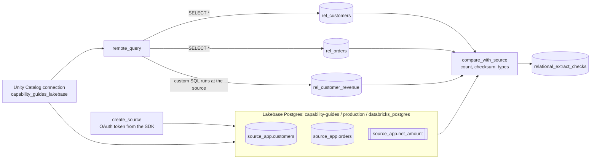

# Relational database extracts

## Overview

Choose the ingestion path for a relational source by freshness, volume, and source load: Lakehouse Federation to query in place, Lakeflow Connect CDC connectors for continuous replication, or query-based connectors for scheduled incremental pulls. Push joins and aggregates down to the database, and verify landed data against the source. This reference shows the Federation pushdown path and the verification.

## What this shows

| Extract | Landed table | Rows | Match with the source |
|---|---|---|---|
| Full table `source_app.customers` | `rel_customers` | 200 | same row count and checksum; `decimal(12,2)` and `date` types preserved |
| Full table `source_app.orders` | `rel_orders` | 1,000 | same row count and checksum; types preserved |
| Custom SQL (join, `sum`, `rank() OVER`, `source_app.net_amount()`) | `rel_customer_revenue` | 200 | same row count and checksum as the query run directly in Postgres |

The checksum is the sum of the first 8 hex digits of `md5` over a canonical row string, computed in Postgres SQL on one side and Spark SQL on the other (`src/source_ingestion/checksum.py`). Results are in `relational_extract_checks`.

## Architecture



## Reference code

- `src/source_ingestion/relational_sql.py`: the source DDL, the `net_amount` database function, and `CUSTOM_QUERY`
- `relational-db-ingestion/01_create_source`: connects with `w.postgres.generate_database_credential`, creates `source_app`, loads the rows
- `relational-db-ingestion/02_setup_federation`: creates or refreshes the connection and tries to create the foreign catalog
- `relational-db-ingestion/03_extract`: `remote_query` for full tables and the custom query
- `relational-db-ingestion/04_compare_with_source` and `src/source_ingestion/checksum.py`: the comparison
- `resources/relational_extract.job.yml`

## Demo steps

1. Open the latest run of `capability-guides-relational-extract` and walk the four tasks.
2. In the `create_source` output, find the source row counts (200 customers, 1,000 orders).
3. Open `CUSTOM_QUERY` in `relational_sql.py` and point out the join, the aggregate, the function call, and the window.
4. Compare the landed result with the source query output in `compare_with_source`:
   ```sql
   SELECT table_name, source_rows, landed_rows, source_checksum, landed_checksum, types_match, passed
   FROM <catalog>.<schema>.relational_extract_checks ORDER BY checked_at DESC;
   ```
5. Show the types that arrived:
   ```sql
   DESCRIBE TABLE <catalog>.<schema>.rel_customers;
   ```
6. Read the top customer in each country:
   ```sql
   SELECT country, segment, order_count, net_revenue FROM <catalog>.<schema>.rel_customer_revenue
   WHERE country_rank = 1 ORDER BY country;
   ```

## Reference run

One job builds a small source in Lakebase Postgres, connects Databricks to it through a Unity Catalog connection, and lands two kinds of extract: full tables and the result of a custom SQL query. The custom query joins two tables, aggregates per customer, calls a database function, and ranks customers inside each country with a window function. All of it runs inside Postgres. A last task re-runs each query at the source and compares row counts, a checksum, and column types with the landed Delta tables.

Artifacts:

- Job `capability-guides-relational-extract` (tag `capability_guide_job: capability_guides_relational_extract`)
- Tables `rel_customers`, `rel_orders`, `rel_customer_revenue`, `relational_extract_log`, `relational_extract_checks`
- Outside the bundle: schema `source_app` in the `databricks_postgres` database of Lakebase project `capability-guides` (branch `production`), and the Unity Catalog connection `capability_guides_lakebase`

## Limitations and next steps

- The foreign catalog could not be created in the reference workspace because the running user lacks `CREATE CATALOG` on the metastore. The extract uses `remote_query` on the connection, which needs no catalog. With the privilege, `CREATE FOREIGN CATALOG ... USING CONNECTION` lets you query the tables in place and join them with Delta tables.
- The connection stores a Lakebase OAuth token as its password, and tokens last about an hour. The job replaces the token on every run. A production connection uses a long-lived credential from a secret store.
- Each run re-extracts every table. This is the right shape for small tables and one-off loads.
- For production CDC, use a Lakeflow Connect managed connector. SQL Server, Oracle, PostgreSQL, MySQL and other databases have connectors that read the transaction log or run incremental queries, track schema changes, and apply updates and deletes without custom code. The pattern here is for ad hoc extracts and for sources that have no connector.
