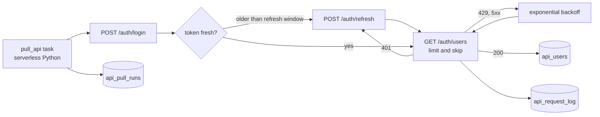

# Authenticated REST API ingestion

## Overview

Use a managed Lakeflow Connect connector when one exists. Otherwise build a custom connector, wrap the API in a Python data source, or land raw responses for Auto Loader. Keep credentials in Unity Catalog connections or secret scopes, pull incrementally with a stored cursor, upsert with MERGE, and retry only the errors a retry can fix. This reference implements the land-raw path with a hand-written client.

## Required setup

Run this once, before the job.

1. **Outbound internet to the API host.** The task calls `https://dummyjson.com` (`rest_api.base_url` in `use_cases/general.yml`) over HTTPS on port 443. If the workspace restricts serverless egress, add `dummyjson.com` to the allowed destinations of its network policy (set in the account console; see [network policies](https://docs.databricks.com/aws/en/security/network/serverless-network-security/network-policies)). To pull from your own API, change `rest_api.base_url`, `username`, `password`, and `endpoint` in the same file.

## What this shows

| Capability | Artifact |
|---|---|
| Authenticated pull | `POST /auth/login` returns a bearer token; every page request sends it in the `Authorization` header |
| Pagination | `limit` and `skip` parameters, followed until `skip` reaches the `total` the API reports |
| Token handling | proactive refresh when the token reaches a set age, reactive refresh and retry on a 401 |
| Retries | 429 and 5xx responses and network errors retry with exponential backoff, and a `Retry-After` header takes precedence |
| Every record landed | `api_users`: 208 rows, 208 distinct ids, equal to the API total |
| Request log | `api_request_log`: one row per HTTP attempt with page, skip, status, latency, and token refresh count |
| Run summary | `api_pull_runs`: pages, attempts, retries, logins, refreshes, records |

## Architecture



## Reference code

- `src/source_ingestion/api_client.py`: `TokenManager`, `fetch_all_pages`, and `backoff_delay`. The session is injected, so the loop is tested without a network.
- `rest-api-ingestion/01_pull_rest_api`: the only task. It flattens users (`src/source_ingestion/api_records.py`), writes the three tables, and fails if records, distinct ids, and the API total differ.
- `resources/rest_api.job.yml`: the job (`capability_guides_rest_api`).
- `use_cases/general.yml` (`rest_api` block): base URL, page size, refresh window, retry settings.
- `tests/test_helpers.py`: paging, 401 refresh, 503 and 429 backoff, give-up, and proactive refresh tests.

## Demo steps

1. Open the latest run of `capability-guides-rest-api` and read the task output line: pages, attempts, retries, logins, refreshes, records.
2. Query the summary:
   ```sql
   SELECT * FROM <catalog>.<schema>.api_pull_runs ORDER BY started_at DESC;
   ```
3. Query the request log and find page 4. The first attempt returns 401 (the run sends an invalid token on purpose), the second returns 200 after a refresh:
   ```sql
   SELECT page, attempt, http_status, records, latency_ms, token_refreshes
   FROM <catalog>.<schema>.api_request_log ORDER BY page, attempt;
   ```
4. Show that nothing is duplicated:
   ```sql
   SELECT count(*), count(DISTINCT user_id) FROM <catalog>.<schema>.api_users;
   ```
5. Open `api_client.py` and walk `fetch_all_pages`: one log row per attempt, one retry path per status class.
6. Change `rest_api.page_size` in `use_cases/general.yml`, redeploy, and rerun. The page count changes and the record count does not.

## Reference run

One job calls a paginated, token-authenticated REST API, follows every page, refreshes the token, retries failures with backoff, and lands the records in a Delta table with a log of every HTTP request. The reference run pulls 208 users from the public DummyJSON test API in 7 pages. It logs in once, refreshes the token three times, and survives a 401 that the run injects on page 4.

Artifacts:

- Job `capability-guides-rest-api` (tag `capability_guide_job: capability_guides_rest_api`)
- Tables `api_users`, `api_request_log`, and `api_pull_runs` in the guide schema

## Limitations and next steps

- DummyJSON is a test API. It returns a refresh token and accepts a 401 injection, but it never throttles, so the run exercises the 429 and 5xx backoff in unit tests only.
- The run shortens the refresh window to 3 seconds and adds a one-second delay per page so that refresh happens. A real API uses its issued token lifetime.
- The credentials are the test API's published demo user. For a real API, put the client secret in a secret scope and read it with `dbutils.secrets.get`.
- The pull overwrites `api_users` each run. For a large API, add a cursor or `modified_since` parameter and merge.
- For a source you read often, the PySpark custom data source API wraps a client like this one behind `spark.read.format("...")`, with partitioned reads and streaming support. See https://docs.databricks.com/aws/en/pyspark/datasources (Azure: https://learn.microsoft.com/en-us/azure/databricks/pyspark/datasources).
- Lakeflow Connect has managed connectors for common SaaS APIs. Use one when the source is on the list.
