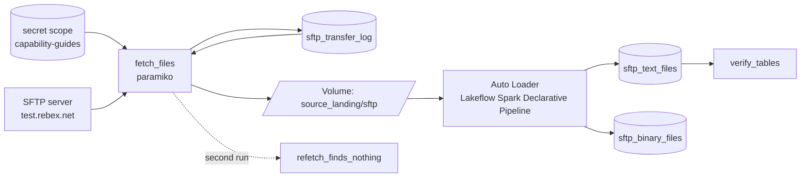

# SFTP file retrieval

## Overview

Read from SFTP with the Lakeflow Connect SFTP connector: a Unity Catalog connection with a PEM private key, plus Auto Loader. Open the network path for classic or serverless egress addresses. A copy-to-volume job is the fallback when the connector does not fit. This reference implements the fallback copy loop against a public test server.

## What this shows

| Capability | Artifact |
|---|---|
| Credentials in a secret scope | scope `capability-guides` with keys `sftp-username` and `sftp-password`, created by the `setup_secrets` task (`01_setup_secrets`) |
| Retrieval | `fetch_files` lists the server recursively and copies 17 files (2 text, 15 PNG) to the volume under `sftp/`, keeping the remote folder layout |
| No re-copy | `sftp_transfer_log` keys each file on path, size, and modification time. `refetch_finds_nothing` copies 0 of 17 |
| No reprocessing | Auto Loader tracks files in its checkpoint. `sftp_text_files` has 2 rows and `sftp_binary_files` has 15 rows, one per file |
| Verification | `verify_tables` fails if copied and ingested file counts differ |

## Architecture



## Reference code

- `sftp-ingestion/01_setup_secrets`: creates the scope and writes the two secrets with the SDK
- `sftp-ingestion/02_fetch_files` and `04_refetch_finds_nothing`: call `src/source_ingestion/sftp_fetch.py`, which connects with paramiko, plans transfers, copies files, and writes the log
- `sftp-ingestion/03_run_pipeline` and `05_verify_tables`: run or inspect the pipeline, then check the counts
- `src/source_ingestion/sftp_utils.py`: `walk_remote`, `plan_transfers`, and the `VolumeRemote` stand-in
- `sftp-ingestion/pipeline/*.sql`: the two streaming tables
- `resources/sftp.job.yml` and `resources/sftp.pipeline.yml`
- `tests/test_helpers.py`: tree walk, new-file planning, and file classification

## Demo steps

1. Open `sftp-ingestion/00_start_here`, then the latest run of `capability-guides-sftp`, and walk the tasks in order. To run by hand, open each notebook in order and use Run all.
2. Show the secret keys without values: `databricks secrets list-secrets capability-guides`.
3. Compare the two fetch runs:
   ```sql
   SELECT task, mode, remote_files, new_files FROM <catalog>.<schema>.sftp_transfer_runs ORDER BY finished_at;
   ```
4. List the copied files by kind:
   ```sql
   SELECT kind, count(*) FROM <catalog>.<schema>.sftp_transfer_log GROUP BY kind;
   ```
5. Read an ingested text file:
   ```sql
   SELECT source_file, file_size, content FROM <catalog>.<schema>.sftp_text_files;
   ```
6. Run the job again. `fetch_files` copies 0 files and the pipeline update processes 0 new rows.

## Reference run

One job connects to an SFTP server with credentials from a Databricks secret scope, copies the files it has not copied before to a Unity Catalog volume, and ingests them with a Lakeflow Spark Declarative Pipeline and Auto Loader. A second fetch right after ingestion finds nothing new. The reference run uses the public read-only server `test.rebex.net`, which is reachable from serverless compute.

Artifacts:

- Job `capability-guides-sftp` (tag `capability_guide_job: capability_guides_sftp`) and pipeline `capability-guides-sftp`
- Secret scope `capability-guides` (created outside the bundle, see below)
- Tables `sftp_transfer_log`, `sftp_transfer_runs`, `sftp_text_files`, `sftp_binary_files`

## Limitations and next steps

- Secret scopes are not a bundle resource, so the first task creates `capability-guides`. Delete it with `databricks secrets delete-scope capability-guides` when you are done.
- The server publishes its demo credentials. A real server's values go in the same two keys. For key-based auth, store the private key as a third secret.
- The fetch notebooks set `allow_volume_fallback=True`. If outbound SFTP is blocked from serverless, the same copy logic runs against a folder in the volume, and the run records `mode = volume_fallback` plus the connection error in `sftp_transfer_runs`. In the reference run the server was reachable, so `mode = sftp`.
- A file counts as new when path, size, or modification time changes. A server that rewrites files in place with the same size and time is not detected.
- Lakeflow Connect also has an SFTP connector (Public Preview). Use it when you want managed incremental file pulls without writing the copy step.
