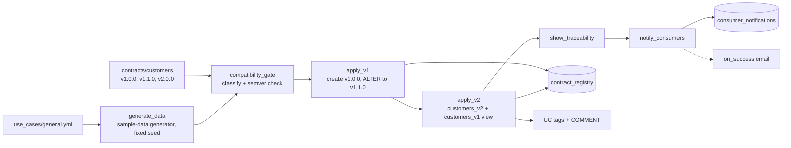

# Data contract versioning

## Overview

The release job treats a dataset's schema as a versioned data contract. It publishes a nonbreaking change in place (v1.0.0 to v1.1.0), then a breaking change (v2.0.0) as a new table with a deprecated compatibility view that keeps the old shape alive. A gate compares contract versions and fails the job when the semantic version bump does not match the change. A registry, Unity Catalog tags, and a consumer notification table record what happened.

## What this shows

| Success criterion | Artifact |
|---|---|
| Nonbreaking changes | `contracts/customers/v1.1.0.yml` adds a nullable `loyalty_tier`; `apply_v1` runs `ALTER TABLE ADD COLUMN` on the existing table |
| Breaking changes | `contracts/customers/v2.0.0.yml` renames two columns and narrows `lifetime_value` (`bigint`) to `lifetime_value_usd` (`decimal(18,2)`); published as `customers_v2` |
| Traceability | `contract_registry` (dataset, version, change type, release tag, applied time, Delta table version), `DESCRIBE HISTORY`, and the `release` tag on the job |
| Consumer notification | `consumer_notifications` (one row per consumer in the spec, with message, action required, deadline) and the job's `on_success` email |
| Compatibility | `compatibility.py` classifies each change; the `02_compatibility_gate` notebook fails on a mislabeled bump and logs a dry run that proves it; `customers_v1` view keeps the v1.1.0 shape over v2 data |
| Deprecation handling | UC tags `contract_version`, `deprecated=true`, `sunset_date` plus a COMMENT naming what to migrate to, on the `customers_v1` view and the archived v1 table |

## Architecture



## Reference code

- `contracts/customers/v*.yml`: columns, types, nullability, `renamed_from`, `deprecates`, `sunset_date`
- `use_cases/general.yml`: dataset, owner, consumers, seed, and sample-data options
- `src/compatibility.py`: `diff_contracts`, `check_contracts` (classification plus semver rule), `evolve_sql`, `compat_view_select`
- `src/versioning_common.py`: spec loading, registry writes, tags
- `guides/versioning/00_start_here`: what the guide shows, the notebooks in order, and the variables
- `guides/versioning/01_generate_data`, `02_compatibility_gate` (gate over all published versions plus the mislabeled dry run), `03_apply_v1` (in-place evolution), `04_apply_v2` (new table, compatibility view, tags, comments, registry rows), `05_show_traceability`, `06_notify_consumers` (per-consumer impact and action)
- `requirements.txt`: pyyaml and the Databricks SDK, installed by the notebooks that need them
- `resources/release.job.yml`: serverless job and `on_success` email; each task runs one notebook
- `tests/test_compatibility.py`: unit tests, including rejected mislabeled releases

## Demo steps

1. Open `contracts/customers/` and compare v1.0.0, v1.1.0 and v2.0.0.
2. Run `python -m pytest tests` in the bundle folder. Point out the tests that expect the gate to reject a breaking change labeled 1.2.0.
3. Open the latest successful run of `capability-guides-versioning-release`.
4. In `compatibility_gate`, read the classified changes and the `DRY RUN ... REJECTED` line.
5. In `apply_v1`, show the `ALTER TABLE ... ADD COLUMN` statement. The table was never recreated.
6. Query the registry:
   ```sql
   SELECT * FROM <catalog>.<schema>.contract_registry ORDER BY applied_at;
   ```
7. In `show_traceability`, show `DESCRIBE HISTORY` and the tag listing. Open `customers_v1` in Catalog Explorer to see the deprecation comment and tags.
8. Run `SELECT * FROM <catalog>.<schema>.customers_v1 LIMIT 5` (old column names) next to `customers_v2` (new names).
9. Query `consumer_notifications`. Only `finance-reporting` has required changes.
10. Show the `on_success` email setting on the job.

## Artifacts produced

- Tables: `customers_seed`, `customers_v1_archive` (deprecated physical v1.1.0 data), `customers_v2`, `contract_registry`, `consumer_notifications`
- View: `customers_v1` (deprecated compatibility view over `customers_v2`)
- Unity Catalog tags on `customers_v1`, `customers_v1_archive`, `customers_v2`: `contract_version`, `deprecated`, `sunset_date`
- A job run with the gate output, Delta history, and tag listings in the task logs

## Limitations and next steps

- The gate runs inside the job. In CI, run the same `compatibility.py` on pull requests so a mislabeled contract fails before merge.
- The notification step writes a table and relies on the job email for announcement. Routing per-consumer messages to Slack, email, or tickets needs a delivery step or webhook destinations.
- Column-level compatibility only. Semantics (units, meaning of values) and row-level rules are not checked.
- Rename detection depends on `renamed_from` in the contract. Without it, a rename reads as a drop plus an add column.
- Sunset is recorded, not enforced. A scheduled job that drops `customers_v1` after `sunset_date` is the next step.
- Consumers read `customers_v1` through the view, so usage lineage in Unity Catalog shows who still depends on the deprecated name.
