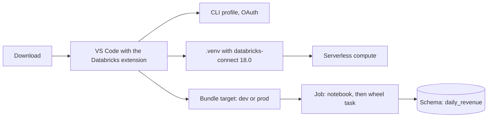

# Working with Databricks in VS Code

## Overview

The Databricks IDE extension ties one local project to one workspace: a CLI profile signs you in with OAuth, a bundle target says where code deploys, and a compute choice says where it runs. This starter is a small bundle project that exercises each of those in the editor. It holds a Python package that cleans orders and totals revenue per day and category, a notebook that calls it, a script to debug, pytest tests, and a serverless Lakeflow job with a notebook task and a Python wheel task. Job key: `capability_guides_vscode_starter`.

The guide page offers the project as a zip. You unzip it, open the folder in VS Code, sign in, and follow the numbered demo steps in its `README.md`. The folder `reference/vscode-starter/` is the download, minus `resources/app_access.yml` and this file (see Limitations).

## What this shows

| Step | How | Result in the reference run |
|---|---|---|
| Validate | `databricks bundle validate --strict` | Passes for `dev` and `prod`. |
| Unit tests | `pytest` with no profile | 3 pass; the Databricks Connect test skips in about two seconds. |
| Environment | `uv sync` | `.venv` with Python 3.12 and `databricks-connect` 18.0.9. |
| Debug a script | `scratch/explore.py` with `DatabricksSession.builder.serverless()` | Drops 3 of 8 orders locally, then prints 3 daily revenue rows from serverless compute. |
| Connect test | `pytest` with the profile set | The Spark total matches the pandas total. |
| Deploy to `dev` | `databricks bundle deploy` | Builds the wheel, then creates a schema and a job, both prefixed `dev_<you>` or `[dev <you>]`. |
| Run | `databricks bundle run capability_guides_vscode_starter` | Succeeded in 68 seconds: notebook task 40 seconds, wheel task 26 seconds. |
| Result | `daily_revenue` | 3 rows: books on 2026-01-01 (2 orders, 40.00), games on 2026-01-02 (1 order, 15.00), games on 2026-01-03 (1 order, 25.00). |
| Clean extract | Unzip the download, `bundle validate` with only `catalog` set | Passes. |

## What the runs taught

- **Match `databricks-connect` to the serverless environment version.** `databricks environments setup-local --serverless-version 5` resolves to Python 3.12 and `databricks-connect` 18.0.x, and the release notes list Databricks Connect 18 for version 5. The job's `environment_version` is `"5"` to match.
- **A serverless job needs an environment for the wheel.** The job lists `dist/*.whl` under `environments`, and each task names the environment with `environment_key`. The bundle builds the wheel with `uv build` through the `artifacts` block.
- **Use the schema resource's name, not the variable.** Development mode renames the schema to `dev_<you>_vscode_starter`. The wheel task reads `${resources.schemas.demo.name}`, which carries the prefix.
- **`validate --strict` wants the deploy identity in `permissions`.** Without a top-level `permissions` entry for `${workspace.current_user.userName}`, strict mode fails on a warning.
- **The wheel entry point needs `serverless()` only off Databricks.** On Databricks compute `DatabricksSession.builder.getOrCreate()` returns the running session. On your machine it fails with "Cluster id or serverless are required" unless you call `.serverless()` or set a cluster.
- **The bundle skips `scratch/`, `tests/`, and `.vscode/`.** The `sync.exclude` list keeps them on your machine.
- **The app permission lives in its own file.** `resources/app_access.yml` holds the `app_service_principal` variable and the `CAN_RUN` grant. The zip leaves it out, so a downloaded copy needs only `catalog`.

## Architecture

## Reference code

- `databricks.yml`: bundle name, wheel build, `catalog` variable, `dev` and `prod` targets
- `resources/orders.job.yml`: serverless job with a notebook task and a Python wheel task
- `resources/orders.schema.yml`: the per-user dev schema
- `resources/app_access.yml`: the app service principal's `CAN_RUN` grant (not in the download)
- `src/orders_demo/orders.py`: `clean_orders`, `daily_revenue`, and `spark_daily_revenue`
- `src/orders_demo/main.py`: the `orders-demo` entry point the wheel task runs
- `src/notebook.py`: source-format notebook that runs cell by cell through Databricks Connect
- `scratch/explore.py`: the script to debug with a breakpoint
- `tests/test_orders.py`, `tests/test_connect.py`: local unit tests and the optional Connect test
- `pyproject.toml`: the `databricks-connect==18.0.*` pin, pytest, and ruff settings
- `.vscode/launch.json`: debugpy configurations with `"databricks": true`

## Reference run

Workspace profile with serverless only, `dev` target, catalog set to an existing catalog. The job ran for 68 seconds. The notebook task took 40 seconds and the wheel task 26. The wheel task wrote 3 rows to `daily_revenue` in the schema `dev_<you>_vscode_starter`: 8 sample orders, 3 dropped (a missing customer, a zero quantity, an unknown status), 1 more left out of the daily totals because it was cancelled. Revenue across the three rows is 80.00. Running `orders-demo` from a laptop through Databricks Connect wrote the same table.

## Demo steps

1. Download the starter from the guide page and unzip it.
2. Open the folder in VS Code and install the recommended extensions.
3. Sign in with OAuth (user to machine), pick Serverless, and set up the Python environment.
4. Run `src/notebook.py` cell by cell.
5. Set a breakpoint in `scratch/explore.py` and debug it with Databricks Connect.
6. Run the tests from the Testing panel. Use the Debug icon for the Connect test.
7. Deploy from the Bundle Resource Explorer and run the job. Open Run Status to follow it.
8. Change `clean_orders`, run the tests, and redeploy.
9. Deploy to `prod`, then destroy each target.

The full numbered script is in the download's `README.md`.

## Limitations

- The VS Code UI steps were not run: Run Cell, Debug current file with Databricks Connect, the Testing panel, and the Resource Explorer icons. The CLI, Databricks Connect, and bundle steps ran against a workspace. The UI steps follow the extension docs.
- The `launch.json` entries follow the documented shape (`debugpy` with `"databricks": true`). The `"purpose": ["debug-test"]` field is standard VS Code Python debugging, not something the Databricks docs mention.
- The sample data is eight hard-coded orders, enough to exercise the editor workflow.
- The `prod` target here deploys from one person's user folder with that person's identity. Add `run_as` a service principal before you rely on it.
- `resources/app_access.yml` makes `app_service_principal` a required variable in this repo. The download drops the file, and with it the variable and the grant.
- `bundle destroy` drops the schema and its tables.
